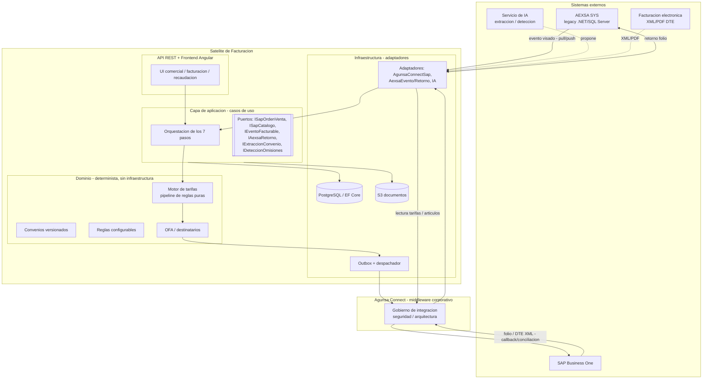
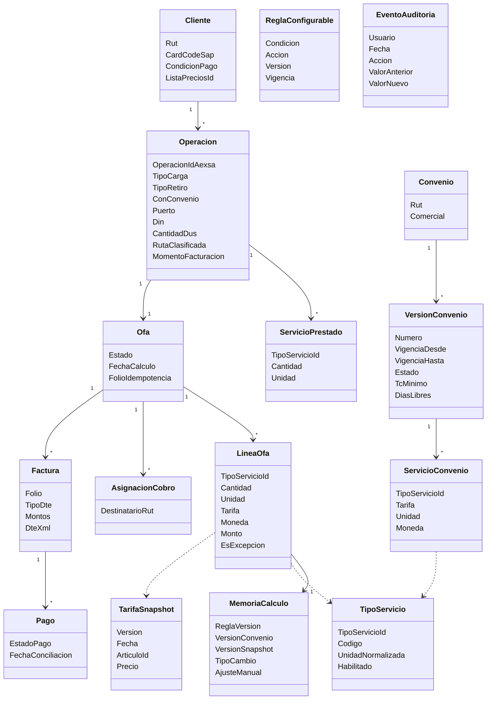

# Diseño — Satélite de Facturación AEXSA

Versión: 1.0
Fecha: 2026-10-26
Autor: Arquitecto de Solución (`arquitecto-satelite`)
Entrada: `requirements.md` v1.1 (REQ-001…REQ-012), catálogos del levantamiento (RN, BR, PQ), `handoff-arquitecto.md`, principios de arquitectura (steering).
Decisiones: ver ADRs en `docs/arquitectura/adr/` (ADR-001…ADR-011). Preguntas técnicas abiertas: `docs/arquitectura/preguntas-arquitectura.md` (PA-001…PA-008).

> Este documento define el **CÓMO**. No reabre decisiones de negocio cerradas (handoff §2). Donde una pieza depende de un tercero (SAP, Agunsa Connect, AEXSA SYS, seguridad), se diseña detrás de un **puerto** para que el Satélite se construya y pruebe sin esperar a esa resolución, y la dependencia queda marcada como PA en estado *Propuesto*.

---

## 1. Resumen ejecutivo

El Satélite es un sistema nuevo que centraliza los eventos facturables de AEXSA SYS, calcula los montos de forma **determinística y auditable**, arma una **OFA valorizada** (orden de venta de SAP), cierra el lazo devolviendo el folio a AEXSA SYS para liberar la carga, y da trazabilidad extremo a extremo para **detectar omisiones de cobro**.

Dos principios gobiernan el diseño:
1. **El monto nunca lo fija la IA.** El cálculo es un motor de reglas determinístico y versionado (ADR-006). La IA solo extrae, propone y alerta, con confirmación humana (ADR-007, ADR-008, ADR-009).
2. **Manda el negocio sobre el legacy.** Repartido (RN-077) y cobro por DUS (RN-047) son capacidades nuevas a construir (ADR-011).

El mayor riesgo técnico es la **escritura hacia SAP** (no existe canal, RN-076/BR-027/PQ-029) y su gobierno por **Agunsa Connect** (BR-028/PQ-030). El diseño lo aísla con el patrón Outbox + adaptadores (ADR-002) de modo que ese riesgo no bloquee la construcción del resto.

---

## 2. Arquitectura general

Arquitectura hexagonal (puertos y adaptadores), desplegada como servicio modular en AWS (ADR-001).



### 2.1 Capas
- **Dominio:** motor de tarifas (ADR-006), convenios (ADR-007), reglas configurables (ADR-008), OFA y destinatarios (ADR-011). Determinístico, sin dependencias de infraestructura, cubierto por pruebas.
- **Aplicación:** casos de uso que orquestan los 7 pasos; define los **puertos** hacia el exterior.
- **Infraestructura:** EF Core/PostgreSQL, Outbox + despachador, S3, adaptadores de Agunsa Connect/AEXSA/IA.
- **API + Frontend:** REST para Angular (comercial, facturación, recaudación) y para callbacks de integración.

### 2.2 Despliegue (AWS)
ECS Fargate (API + worker de Outbox), RDS PostgreSQL, S3 (documentos), CloudFront + WAF (frontend), GitHub Actions + ECR (CI/CD). Comunicación con SAP/AEXSA por Agunsa Connect (RNF-05).

---

## 3. Modelo de dominio

Centrado en la **Operación**; versionado y auditable (ADR-010).



Notas:
- **Identidad por RUT** (BR-020); mapeo a `CardCode` de SAP (RN-065).
- **MemoriaCalculo** y **EventoAuditoria** son **append-only** (reconstrucción del "por qué", REQ-011).
- **Folio** es la clave de cuadratura operación↔OFA↔factura↔pago (RNF-02, RN-029).
- Una Operación puede tener **varias Facturas** (repartido/complementarias, ADR-011).

---

## 4. Flujo extremo a extremo (los 7 pasos)

```mermaid
sequenceDiagram
    participant AEXSA as AEXSA SYS
    participant SAT as Satelite
    participant MOTOR as Motor de tarifas
    participant OUT as Outbox
    participant GW as Agunsa Connect
    participant SAP as SAP B1

    Note over AEXSA,SAT: Paso 1 - evento facturable (REQ-001/002/003)
    AEXSA->>SAT: visado aprobado (pull/push)
    SAT->>SAT: valida DIN vs papeleta; clasifica ruta; destinatario(s)
    Note over SAT: Paso 2 - convenio vigente (REQ-004/012)
    SAT->>SAT: resuelve VersionConvenio vigente (fuente: Satelite)
    Note over SAT,MOTOR: Paso 3 - calculo determinista (REQ-005/006/007)
    SAT->>MOTOR: ContextoCalculo (operacion + convenio + snapshot + TC)
    MOTOR-->>SAT: lineas valorizadas + MemoriaCalculo
    SAT->>SAT: deteccion de omisiones (propone faltantes)
    Note over SAT: Paso 4 - arma y valida OFA (REQ-008)
    SAT->>SAT: OFA valorizada (multi-destinatario); valida completitud
    SAT->>OUT: encola OFA (misma transaccion)
    Note over OUT,SAP: Paso 5 - emision (REQ-009)
    OUT->>GW: crear orden de venta (idempotente, reintentos)
    GW->>SAP: orden de venta -> factura
    SAP-->>GW: folio + DTE
    GW-->>SAT: callback folio / DTE XML
    SAT->>SAT: cierra vinculo operacion-factura por folio
    SAT->>AEXSA: retorna folio -> habilita check de salida (RN-072)
    Note over SAT,SAP: Paso 6 - pago (REQ-010)
    SAP-->>SAT: Pago Recibido conciliado (estado por folio)
    Note over SAT: Paso 7 - historico y auditoria (REQ-011)
    SAT->>SAT: registra historico reconstruible; KPIs
```

### 4.1 Cuadraturas obligatorias (principios)
En cada tramo el Satélite cuadra y, ante desbalance, alerta:
- eventos AEXSA SYS ↔ operaciones en el Satélite (ingesta, ADR-005);
- operación ↔ OFA (toda operación facturable produce OFA o queda marcada no facturable);
- OFA ↔ documentos SAP (toda OFA enviada termina con folio o error explícito, RNF-07);
- factura ↔ pago (conciliación por folio, REQ-010);
- prestado ↔ facturado (detección de omisiones, ADR-009).

---

## 5. Diseño por requerimiento (trazabilidad REQ → diseño)

| REQ | Cómo se diseña | ADR |
|-----|----------------|-----|
| REQ-001 Evento facturable | Puerto `IEventoFacturable` (pull por defecto, push si viable); valida DIN↔papeleta; clasifica momento por convenio | ADR-005 |
| REQ-002 Clasificación de ruta | Regla de clasificación {carga}×{retiro}×{convenio} en el dominio; recalcula si directo→indirecto | ADR-006 |
| REQ-003 Destinatario(s) | `AsignacionCobro` multi-destinatario; default consignatario DIN; registra origen de instrucción; RUT de la DIN | ADR-011 |
| REQ-004 Convenio vigente | Convenio versionado como fuente; multi-convenio → más antiguo + override; alerta vencimiento | ADR-007 |
| REQ-005 Cálculo determinístico | Pipeline de reglas puras; USD→CLP con piso; días libres/aforo; recargos; mayor m³/ton; DUS/BL; guarda versiones | ADR-006, ADR-011 |
| REQ-006 Capa configurable | 3 niveles (código/datos/ajuste manual) + promoción; ajuste auditable; IA propone | ADR-008 |
| REQ-007 Detección de omisiones | Cruce determinístico prestado↔valorizado + IA que propone; alerta complementarias tardías | ADR-009 |
| REQ-008 OFA hacia SAP | OFA valorizada + validación de completitud; bloquea si incompleta; entrega por Outbox | ADR-002, ADR-010 |
| REQ-009 Emisión y folio | Outbox→Agunsa Connect→SAP; callback de folio; retorno a AEXSA; emitida-sin-confirmación + alerta | ADR-002, ADR-004 |
| REQ-010 Pago y conciliación | Recibe estado de pago por folio; soporta pago agrupado multi-factura/multi-cliente | ADR-004, ADR-010 |
| REQ-011 Histórico y auditoría | `MemoriaCalculo` + `EventoAuditoria` append-only; reconstrucción por versión | ADR-010 |
| REQ-012 Convenio en el Satélite | Ingreso por extracción IA (propuesta + confirmación) o manual; versión y vigencia; histórico | ADR-007 |

---

## 6. Integraciones (contratos y resiliencia)

Cada integración define disparador, contrato, idempotencia, reintentos, errores, reproceso y auditoría (principios).

| Integración | Dirección | Puerto | Mecanismo | Idempotencia | Estado |
|-------------|-----------|--------|-----------|--------------|--------|
| Evento facturable | AEXSA → Satélite | `IEventoFacturable` | Pull a vista/API (push si hay webhook) | por `operacionId` | PA-006 |
| Lectura tarifas | SAP → Satélite | `ISapCatalogo` | API consulta + snapshot versionado | sync idempotente | PA-003, PA-007 |
| Escritura OFA | Satélite → SAP | `ISapOrdenVenta` | Outbox → Agunsa Connect → SAP | por `OfaId`+versión | PA-001, PA-002 |
| Folio/DTE | SAP → Satélite | (callback) | Callback / conciliación por folio | por folio | PA-002 |
| Retorno AEXSA | Satélite → AEXSA | `IAexsaRetorno` | Reutiliza canal de conciliación por folio | por folio | PA-004, PA-008 |
| Extracción convenio | IA | `IExtraccionConvenio` | Propuesta + confirmación humana | — | — |

Resiliencia (RNF-07): toda OFA enviada termina con **folio o error explícito**; reintentos con backoff; `EMITIDA_SIN_CONFIRMACION` + alerta al agotar; reproceso desde la interfaz sin tocar la BD; log de request/response/error por mensaje.

---

## 7. Seguridad y cumplimiento
- Datos personales de clientes bajo la nueva ley; paso por ciberseguridad antes de implementar (BR-021, PA-005). Cifrado en reposo (RDS) y en tránsito; control de acceso por rol.
- No heredar el antipatrón de credenciales en claro del legacy (BR-016): secretos en AWS Secrets Manager.
- Toda la comunicación con SAP/AEXSA pasa por Agunsa Connect y su gobierno (RNF-05).

---

## 8. Riesgos y dependencias abiertas (resumen)
Los bloqueantes son de terceros, no del desarrollo del Satélite (principio: separar lo que la IA/desarrollo acelera de lo que no):
- **PA-001/PA-002 (crítico):** vía de escritura en SAP y contrato de Agunsa Connect. Mitigado por Outbox + adaptador simulado: el Satélite se construye y prueba sin ello.
- **PA-003/PA-007:** objeto exacto de lectura SAP y mapeo RUT→CardCode. Mitigado por snapshot + stub.
- **PA-004/PA-006/PA-008:** vía de retorno a AEXSA, ingesta del evento, acceso al XML/PDF. Mitigado por puertos.
- **Negocio (no bloquea):** STI vs DPW (PQ-006), mecánica fina del DUS (BR-030). Se absorben con la capa configurable (ADR-008) hasta confirmarse.

---

## 9. Alcance de construcción
- **1ª etapa:** contenedor FULL con/sin convenio; los 7 pasos; OFA→SAP (con adaptador simulado hasta PA-001/PA-002); convenios en el Satélite; cálculo determinístico; capa configurable; detección de omisiones (cruce determinístico); repartido. DUS modelado, activación según alcance de expo.
- **2ª etapa:** carga LCL/suelta (letras A–F), expo por DUS a volumen, licitaciones, gestión contable de notas de crédito/devoluciones (se registran, no se calculan).

Ver el plan de implementación en `tasks.md`.
