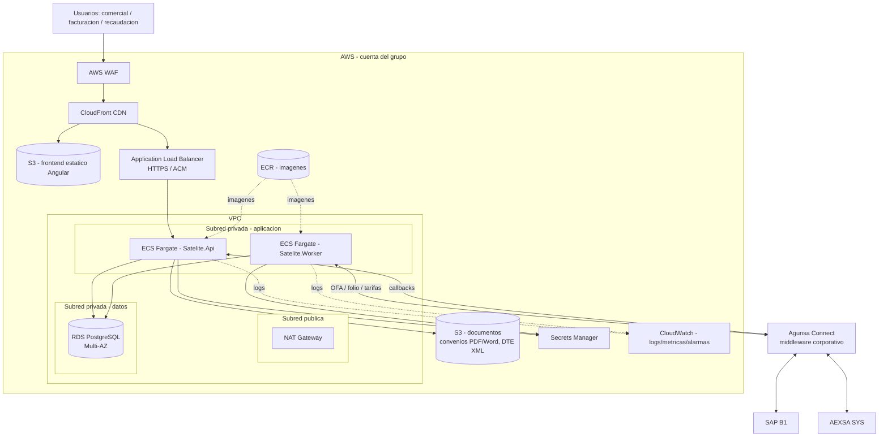
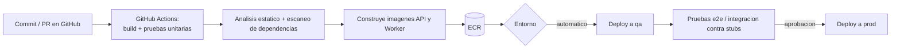

# Arquitectura de despliegue — Satélite de Facturación AEXSA

Versión: 1.0
Fecha: 2026-10-26
Autor: Arquitecto de Solución (`arquitecto-satelite`)
Base: ADR-001 (estilo y stack), ADR-002 (integración SAP/Agunsa Connect), ADR-010 (datos), principios de arquitectura (steering) y estándar corporativo AWS.
Propósito: definir **dónde y cómo se levanta el aplicativo** — infraestructura, entornos, red, seguridad operativa y CI/CD. Complementa los ADR; no reabre decisiones.

> Estándar corporativo (lineamientos de desarrollo): AWS con ECS Fargate, RDS, S3, CloudFront, WAF; CI/CD con GitHub Actions + ECR. Este documento lo concreta para el Satélite.

---

## 1. Visión general

El Satélite se despliega en **AWS**, en la cuenta/VPC del grupo, como un **servicio contenerizado** con tres piezas desplegables que salen de la misma solución .NET (ADR-001):

1. **API** (`Satelite.Api`) — REST para el frontend y los callbacks de integración.
2. **Worker** (`Satelite.Worker`) — procesos en background: despachador del Outbox hacia SAP (ADR-002), sincronización de tarifas (ADR-003), jobs de alertas (vencimiento de convenios, OFA sin folio, impagos).
3. **Frontend** (Angular) — SPA servida como estático por CloudFront.

Toda la comunicación con SAP B1 y AEXSA SYS pasa por **Agunsa Connect** (RNF-05). El Satélite nunca llama directo a esos sistemas.

---

## 2. Componentes de infraestructura

| Componente | Servicio AWS | Función | Nota |
|------------|--------------|---------|------|
| Frontend | **S3 + CloudFront** | SPA Angular estática, CDN, TLS | Origin S3 privado vía OAC |
| Borde | **AWS WAF** | Reglas OWASP, rate-limit, geo | Delante de CloudFront |
| Balanceo | **ALB** (HTTPS, ACM) | Entrada a la API | Solo subred privada tras el ALB |
| API | **ECS Fargate** | `Satelite.Api` | Autoescalado por CPU/solicitudes |
| Worker | **ECS Fargate** | `Satelite.Worker` (Outbox, sync, jobs) | Servicio separado de la API |
| Base de datos | **RDS PostgreSQL Multi-AZ** | Datos del Satélite (ADR-010) | Cifrada (KMS), backups automáticos |
| Documentos | **S3** (bucket privado) | Convenios (PDF/Word), DTE XML | Versionado + cifrado SSE-KMS |
| Secretos | **Secrets Manager** | Credenciales BD, claves de Agunsa Connect | Nunca en config (evita BR-016) |
| Imágenes | **ECR** | Imágenes de API y Worker | Push desde CI |
| Observabilidad | **CloudWatch** | Logs, métricas, alarmas | Trazas de integración (ADR-002) |

### 2.1 Por qué Worker separado de la API
El despachador del Outbox (ADR-002) y la sincronización de tarifas (ADR-003) son procesos de larga duración y con reintentos; separarlos del servicio de la API evita que un pico de integración afecte la latencia de la UI y permite escalarlos de forma independiente.

---

## 3. Red y seguridad

- **VPC con subredes privadas** para aplicación y datos; solo el ALB y CloudFront están expuestos. RDS **no es accesible desde Internet** (subred de datos sin ruta pública).
- **Salida controlada** hacia Agunsa Connect por NAT Gateway / endpoint corporativo, según lo que defina la red del grupo (PA-002).
- **Cifrado:** en tránsito (TLS en ALB/CloudFront y hacia Agunsa Connect) y en reposo (RDS y S3 con KMS). Requisito de datos personales (BR-021, PA-005).
- **Secretos** en Secrets Manager, inyectados al contenedor en runtime; cero credenciales en el repositorio o en la imagen (corrige el antipatrón heredado BR-016).
- **IAM de mínimo privilegio:** cada servicio (API, Worker) con su rol; acceso a S3/Secrets/RDS acotado por política.
- **Auditoría de acceso:** CloudTrail a nivel cuenta; logs de aplicación con el `EventoAuditoria` del dominio (ADR-010).
- Antes de producción: **revisión de ciberseguridad y cumplimiento de la ley de datos personales** (PA-005), condición de salida del F05.

---

## 4. Entornos

| Entorno | Propósito | Integración SAP/AEXSA |
|---------|-----------|------------------------|
| **dev** | Desarrollo e integración continua | Adaptadores **stub** (ADR-002/003/005); sin SAP real |
| **qa / staging** | Pruebas con negocio (F05) y de integración | Agunsa Connect contra ambientes de prueba de SAP/AEXSA (cuando existan, PA-001/PA-002) |
| **prod** | Operación | Agunsa Connect contra SAP/AEXSA productivos |

- Infraestructura por **IaC** (CloudFormation/Terraform, según estándar del grupo) para reproducir entornos.
- La promoción dev → qa → prod es por pipeline, no manual.
- **dev y qa no usan datos personales reales** salvo set de prueba anonimizado (BR-021).

---

## 5. CI/CD (GitHub Actions + ECR)

- **Build + pruebas** en cada PR; el merge a `main` exige pipeline verde (el motor determinístico se cubre con pruebas, principio).
- **Migraciones de BD** (EF Core) se aplican como paso del despliegue, versionadas y reversibles.
- **Secretos del pipeline** en GitHub Actions Secrets / OIDC hacia AWS (sin llaves largas en el repo).
- Despliegue a **prod con aprobación** (compuerta manual), coherente con el paso a producción del F05.

---

## 6. Resiliencia y operación

- **RDS Multi-AZ** con backups automáticos y retención; restauración a punto en el tiempo.
- **Autoescalado** de API y Worker por métricas de CloudWatch.
- **Alarmas:** OFA en `EMITIDA_SIN_CONFIRMACION` (RNF-07), cola de Outbox creciendo, errores de integración, convenios por vencer, impagos. Son las mismas cuadraturas del dominio llevadas a monitoreo.
- **Reproceso de integración desde la interfaz** sin tocar la BD (estándar corporativo de integraciones): el Worker reintenta desde el Outbox; la UI permite relanzar.
- **DR:** la IaC + RDS Multi-AZ + imágenes en ECR permiten reconstruir el entorno; RPO/RTO a definir con TI corporativa.

---

## 7. Dimensionamiento inicial `[SUPUESTO]`
Volumen de referencia (RNF-04): ~2.428 documentos de venta/mes y ~1.468 pagos/mes.
- Carga baja para cómputo: 2 tareas Fargate pequeñas para API + 1 para Worker en prod, con autoescalado. `[SUPUESTO: tamaños a afinar con pruebas de carga]`
- RDS: instancia pequeña Multi-AZ; el volumen de datos lo dominan los registros de auditoría append-only (ADR-010), previsibles y particionables por fecha si crecen.
- No es un sistema de alto throughput; la prioridad es **disponibilidad, trazabilidad y resiliencia de integración**, no rendimiento extremo.

---

## 8. Dependencias abiertas (de `preguntas-arquitectura.md`)
- **PA-002:** forma concreta de conectividad con Agunsa Connect (endpoint, red, protocolo) — define la ruta de salida de la VPC.
- **PA-001:** vía de escritura en SAP — no cambia la infraestructura, sí el adaptador del Worker.
- **PA-005:** controles de ciberseguridad y datos personales exigidos antes de prod.
