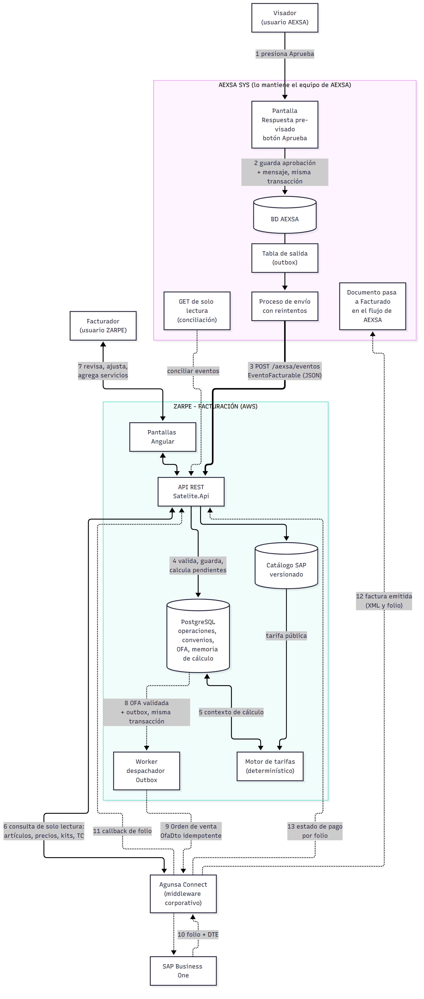
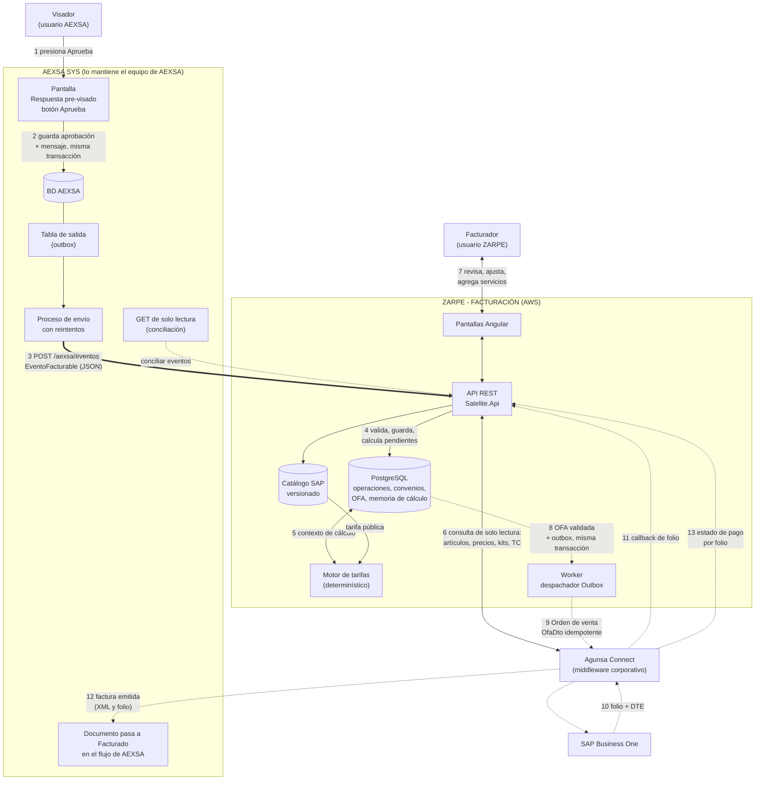
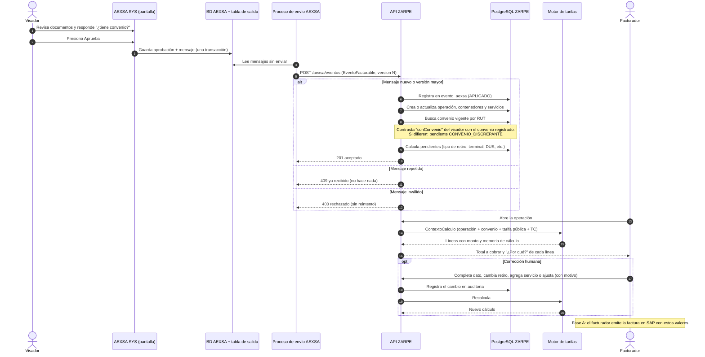
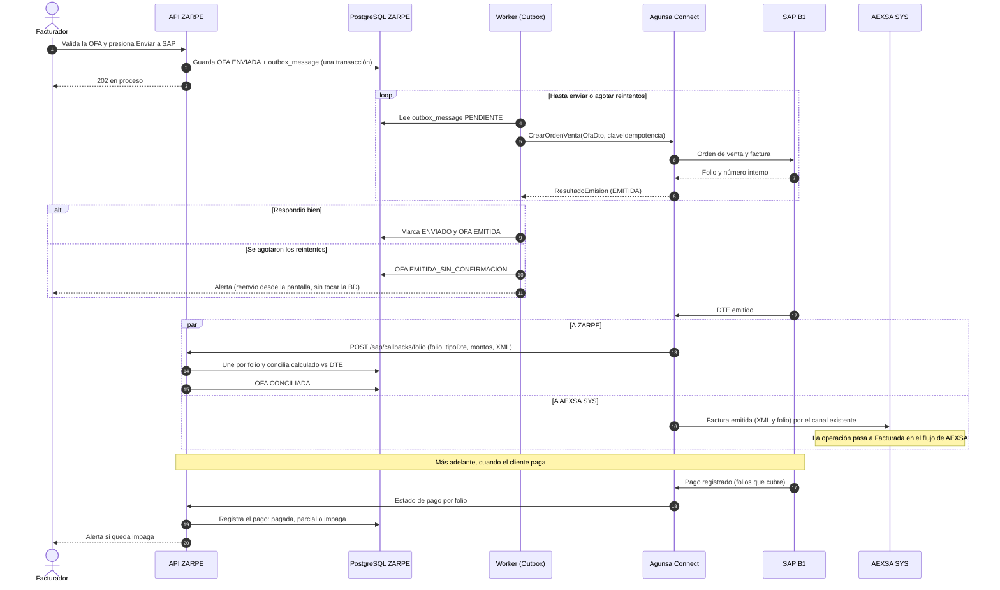
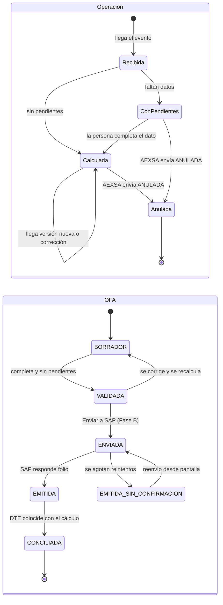

# Flujo de datos y arquitectura — ZARPE - FACTURACIÓN

Versión: 1.0
Fecha: 2026-11-05
Autor: Arquitecto de Solución (`arquitecto-satelite`)
Base: `contratos-integracion.md` (§2 a §6), ADR-002, ADR-005, `arquitectura-despliegue.md`, `modelo-datos.md`.
Propósito: dibujar cómo viajan los datos de AEXSA SYS a ZARPE - FACTURACIÓN y de ahí a SAP, para conversarlo con los desarrolladores. Los diagramas están en Mermaid y se ven en Kiro, GitHub y la mayoría de los editores de Markdown.

> **Qué es Fase A y qué es Fase B.** En la Fase A el sistema recibe el evento de AEXSA SYS y calcula; el facturador factura a mano en SAP. En la Fase B se agrega el envío automático a SAP, el folio de vuelta, los pagos y el retorno a AEXSA SYS. En los diagramas, **línea continua = Fase A**, **línea punteada = Fase B**.

---

## Imágenes listas para abrir o proyectar

Están en `docs/arquitectura/diagramas-uml/`, en PNG (para presentar) y SVG (para ampliar sin perder calidad). Se generan desde los bloques Mermaid de este mismo archivo con `scripts/desarrollo/generar_diagramas_uml.py`; si cambias un diagrama aquí, vuelve a ejecutar el script.

| Imagen | Diagrama UML |
|---|---|
| `01-componentes-flujo-de-datos.png` | Componentes y flujo de datos (vista general) |
| `02-secuencia-aexsa-a-zarpe.png` | Secuencia: de AEXSA a ZARPE (Fase A) |
| `03-secuencia-zarpe-a-sap.png` | Secuencia: de ZARPE a SAP, folio y pagos (Fase B) |
| `04-estados-operacion-y-ofa.png` | Estados de la operación y de la OFA |

---

## Qué tipo de diagrama UML usar para cada pregunta

| Pregunta | Diagrama UML | Dónde está aquí |
|---|---|---|
| ¿Qué piezas hay y cómo se conectan? | **Componentes** | Diagrama 1 |
| ¿Quién habla con quién, en qué orden y con qué datos? | **Secuencia** | Diagramas 2 y 3 |
| ¿Por qué estados pasa una operación o una OFA? | **Estados** (máquina de estados) | Diagrama 4 |
| ¿Dónde corre cada pieza en AWS? | **Despliegue** | `arquitectura-despliegue.md` |
| ¿Qué tablas hay y cómo se relacionan? | **Clases / entidad-relación** | `modelo-datos.md` |

Para conversar con desarrolladores, los más útiles son **Secuencia** (el orden y los datos de cada mensaje) y **Componentes** (el mapa general). Empieza por el Diagrama 1 y luego baja a los de secuencia.

---

## Diagrama 1 — Componentes y flujo de datos (vista general)

Los números de las flechas se explican en la tabla siguiente.

### Qué viaja en cada flecha

| N.º | De → A | Qué viaja | Mecanismo | Fase |
|---|---|---|---|---|
| 1 | Visador → AEXSA | Revisión de documentos y respuesta a "¿tiene convenio?" | Pantalla de AEXSA | A |
| 2 | Pantalla → BD AEXSA | La aprobación y el mensaje del evento, **en una sola transacción** | Escritura en BD | A |
| 3 | AEXSA → ZARPE | `EventoFacturable`: operación, documento de carga, tipo de carga, sentido, tipo de retiro, convenio declarado, terminal, DIN/DUS, partes, contenedores, servicios prestados. **Sin montos tecleados a mano** | `POST /aexsa/eventos`, con reintentos, idempotente por `operacionIdAexsa` + `version` | A |
| 4 | API → BD | Operación, contenedores, servicios, registro del mensaje (`evento_aexsa`), lista de datos pendientes | Escritura transaccional | A |
| 5 | BD ↔ Motor | `ContextoCalculo` inmutable: operación, convenio vigente, tarifa pública, tipo de cambio. Sale: líneas con monto y memoria de cálculo | Llamada interna, sin consultas en vivo | A |
| 6 | ZARPE ↔ SAP (vía Agunsa Connect) | ZARPE **consulta** a SAP, solo lectura: artículos, listas de precios, kits y tipo de cambio. Se guardan como catálogo versionado; el cálculo nunca consulta SAP en vivo | API de consulta, programada y con refresco manual. Si la API aún no está lista, importación de archivos CSV como respaldo `[POR CONFIRMAR]` (PA-003) | A |
| 7 | Facturador ↔ pantallas | Ver cálculo, "¿Por qué?", ajustar monto, agregar servicio, corregir directo/indirecto | HTTPS, rol en la API | A |
| 8 | OFA → Outbox | OFA validada y mensaje de envío, **misma transacción** | Escritura en BD | B |
| 9 | Worker → SAP | `OfaDto`: destinatarios con líneas (artículo SAP, cantidad, tarifa, moneda, monto), clave de idempotencia | Vía Agunsa Connect, reintentos con espera creciente | B |
| 10 | SAP → Agunsa Connect | Folio, número interno, DTE | Respuesta de SAP | B |
| 11 | Agunsa Connect → API | Folio, tipo de DTE, montos, XML del DTE | `POST /sap/callbacks/folio` | B |
| 12 | SAP → AEXSA (vía Agunsa Connect) | La factura emitida (XML del DTE y folio), para que la operación pase a **Facturada** en el flujo de AEXSA y se habilite el check de salida | Canal que ya existe de SAP hacia AEXSA (`GetFactura`). **ZARPE no escribe en AEXSA** `[POR CONFIRMAR]` | B |
| 13 | SAP → ZARPE (vía Agunsa Connect) | Estado de pago de cada factura, por folio: pagada, parcial o impaga. Un pago puede cubrir varias facturas | Callback o consulta `[POR CONFIRMAR]` (PA-002) | B |

---

## Diagrama 2 — Secuencia: de AEXSA a ZARPE - FACTURACIÓN (Fase A)

**Qué mirar al conversarlo con el equipo:**
- AEXSA nunca envía montos. El monto lo calcula siempre el motor.
- El mensaje es idempotente: repetirlo no duplica. Una versión nueva actualiza la operación.
- Lo que falta no hace fallar el mensaje: queda como pendiente y lo completa una persona, con registro.

---

## Diagrama 3 — Secuencia: de ZARPE - FACTURACIÓN a SAP (Fase B)

**Qué mirar al conversarlo con el equipo:**
- Nunca se llama a SAP en línea desde la pantalla: se escribe en el Outbox y un Worker lo envía.
- La clave de idempotencia (`OfaId` + versión) evita crear dos órdenes si se reintenta.
- Cada línea lleva el artículo SAP. Una OFA con una línea sin artículo no pasa la validación.
- `[POR CONFIRMAR]` Cómo se escribe en SAP y cómo fija el precio sin que SAP lo recalcule (PA-001, PA-002). Hasta entonces se construye contra un simulador.
- La factura emitida llega a **dos destinos**: a ZARPE (para conciliar y seguir los pagos) y a AEXSA SYS (para que la operación quede Facturada). A AEXSA llega por el canal que SAP ya usa hoy; ZARPE no escribe en la base de AEXSA.
- El folio es la clave que une operación, OFA, factura y pago.
- `[POR CONFIRMAR]` Con PA-002 y el equipo de SAP: que Agunsa Connect pueda entregar la misma factura a los dos destinos y avisar los pagos a ZARPE.
- `[POR CONFIRMAR]` Las operaciones con convenio no se facturan dentro del flujo de AEXSA (se consolidan fuera, PA-010). Falta definir qué pasa con su estado en AEXSA.

---

## Diagrama 4 — Estados de la operación y de la OFA

Notas:
- La OFA ya enviada no se recalcula: una corrección debe hacerse antes de enviar.
- Un `CONVENIO_DISCREPANTE` o un `DOCUMENTO_CON_VARIAS_SOLICITUDES` exige una decisión registrada antes de pasar a `VALIDADA`.

---

## Diagrama 5 — Dónde corre cada pieza (despliegue en AWS)

Ver `arquitectura-despliegue.md`, §1. En resumen: Angular en S3 + CloudFront (con WAF), API y Worker en ECS Fargate detrás de un balanceador, PostgreSQL en RDS Multi-AZ, documentos en S3 y secretos en Secrets Manager. Toda comunicación con SAP pasa por Agunsa Connect.

---

## Puntos abiertos que afectan estos dibujos

| Punto | Qué cambia en el dibujo |
|---|---|
| PA-002: cómo se conecta Agunsa Connect | Las flechas 6, 9, 10 y 11: transporte, seguridad y quién llama a quién |
| PA-003 y PA-007: API de consulta de SAP | La flecha 6: qué objeto de SAP se consulta y cómo se identifica al cliente por RUT. **Hoy esa API no existe**: sin ella, la Fase A usa archivos |
| Autenticación AEXSA → ZARPE `[POR CONFIRMAR]` | La flecha 3: si va directa o por Agunsa Connect |
| PA-001: cómo se crea la orden en SAP | La flecha 9: el contenido exacto de lo que se envía |
| Factura emitida hacia AEXSA `[POR CONFIRMAR]` | La flecha 12: que el canal existente de SAP a AEXSA siga funcionando igual, y qué pasa con las operaciones con convenio (consolidadas, PA-010) |
| Aviso de pagos a ZARPE `[POR CONFIRMAR]` | La flecha 13: cómo se entera ZARPE de un pago (PA-002, PA-003) |
| Dónde está alojado AEXSA SYS | La red entre AEXSA y AWS (flecha 3) |
