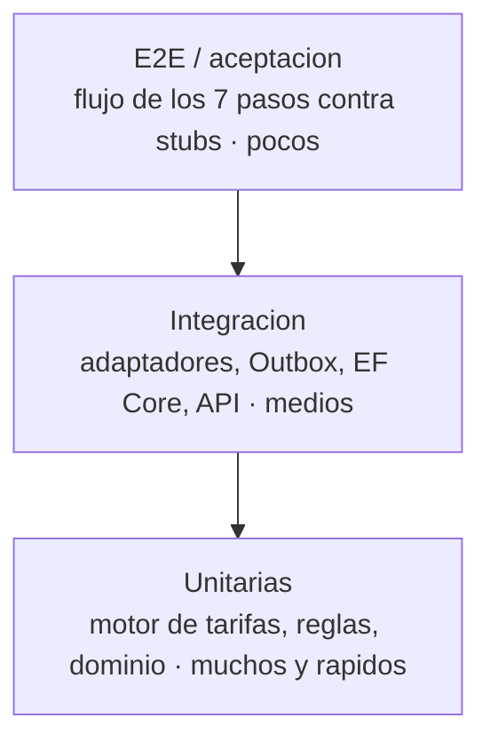

# Estrategia de pruebas — Satélite de Facturación AEXSA

Versión: 1.0
Fecha: 2026-10-28
Autor: Arquitecto de Solución (`arquitecto-satelite`)
Base: ADR-001 (hexagonal), ADR-002 (Outbox/integración), ADR-006 (motor determinístico), ADR-015 (directo STI/DPW), `motor-tarifas-detalle.md`, `contratos-integracion.md`, `openapi.yaml`.
Propósito: definir cómo se prueba el Satélite para que la solución sea **robusta**: determinismo del cálculo garantizado, integraciones verificadas sin depender de terceros, y criterios de aceptación objetivos antes de QA/negocio.

> Principio del proyecto: "el cálculo de montos es lógica determinística, versionada y **con pruebas**". Las pruebas no son opcionales; son la garantía de que el monto es correcto y reproducible (RNF-01, RNF-03).

---

## 1. Pirámide de pruebas (por capa de la arquitectura hexagonal)

El peso está en la **base**: el motor de tarifas y el dominio se prueban con muchos tests unitarios rápidos y deterministas. Las integraciones y el E2E son menos numerosos y usan stubs de los terceros.

| Nivel | Qué prueba | Dependencias | Herramienta (stack .NET) |
|-------|-----------|--------------|--------------------------|
| **Unitarias** | Motor de tarifas, reglas puras, invariantes del dominio | ninguna (sin IO) | xUnit + FluentAssertions |
| **Integración** | EF Core/PostgreSQL, Outbox, adaptadores, endpoints API | PostgreSQL de prueba (Testcontainers), stubs de SAP/AEXSA | xUnit + Testcontainers + WebApplicationFactory |
| **Contrato** | Conformidad con `openapi.yaml` y con los DTO de `contratos-integracion.md` | — | validación de esquema OpenAPI |
| **E2E / aceptación** | Los 7 pasos de punta a punta contra stubs | stubs de SAP/Agunsa Connect/AEXSA | xUnit + entorno dockerizado |

---

## 2. El corazón: pruebas del motor de tarifas (determinismo)

Es la prioridad. El monto debe ser **determinístico, reproducible y auditable**; se garantiza con tres tipos de prueba.

### 2.1 Casos tabulados (los del `motor-tarifas-detalle.md` §5)
Cada caso es un test con entrada fija → salida esperada. Obligatorios (no se puede mergear sin ellos):

| Test | Verifica |
|------|----------|
| T1 | Tarifa convenio CLP simple |
| T2 / T3 | USD sobre piso / bajo piso (RN-022) |
| T4 | Ítem sin convenio → pública + `EsExcepcion` |
| T5 / T6 | Días libres / aforo (RN-023/051/052) |
| T7 | Mayor m³/ton (RN-048) |
| T8 | Cobro por DUS (RN-047) |
| T9 | Recargo 15% (RN-024) |
| **T10 / T10b / T10c** | **Directo STI con valor / DP World en cero / no cobra recepción-despacho (RN-078/079, ADR-015)** |
| T11 | Ajuste manual auditable (REQ-006) |
| T12 | Reproducibilidad |

### 2.2 Prueba de determinismo (propiedad)
- **Reproducibilidad:** dado el mismo `ContextoCalculo`, ejecutar el cálculo N veces produce **exactamente** el mismo resultado y la misma `MemoriaCalculo`. Sin dependencia de reloj, azar, cultura/locale ni estado externo.
- **Property-based testing** (FsCheck): generar operaciones aleatorias válidas y verificar invariantes:
  - el monto nunca es negativo;
  - USD→CLP nunca aplica un TC menor al piso del convenio (RN-022);
  - la suma de líneas por destinatario cuadra con el total de la OFA (repartido, ADR-011);
  - un directo sin convenio nunca contiene recepción/despacho (RN-078).

### 2.3 Reconstrucción auditable
- Para toda línea calculada, la `MemoriaCalculo` permite **recomputar el mismo monto** a partir de las versiones registradas (convenio, snapshot de tarifa, TC, reglas). Test: recalcular desde la memoria == monto almacenado (REQ-011, RNF-01).
- La IA **no participa** del cálculo: test que verifica que ninguna ruta del motor invoca el adaptador de IA.

---

## 3. Pruebas de integración (sin depender de terceros)

Las dependencias externas (SAP, Agunsa Connect, AEXSA SYS) están tras **puertos** (ADR-001/002), así que se prueban con **stubs**; no se necesita el sistema real.

### 3.1 Outbox y escritura a SAP (ADR-002) — el punto crítico de resiliencia
- **Transaccionalidad:** confirmar OFA escribe OFA + `outbox_message` en la **misma transacción** (si falla una, no queda ninguna).
- **Idempotencia:** reenviar la misma OFA (misma `clave_idempotencia`) no crea dos órdenes; el stub de SAP lo verifica.
- **Reintentos:** stub que falla las primeras N veces → el worker reintenta con backoff y finalmente concilia.
- **Folio-o-error (RNF-07):** si el stub nunca responde, la OFA queda `EMITIDA_SIN_CONFIRMACION` y se genera alerta.
- **Callback de folio:** `POST /sap/callbacks/folio` cierra el vínculo por folio y marca la factura.

### 3.2 Ingesta desde AEXSA (ADR-005)
- Pull idempotente: la misma operación no se ingiere dos veces (por `operacion_id_aexsa`).
- Validación DIN↔papeleta: discrepancia → operación `facturable = false` (RN-001).

### 3.3 Lectura de tarifas SAP (ADR-003)
- Sync produce un `tarifa_snapshot` versionado; el cálculo fija y usa esa versión (reproducibilidad).
- Stub con datos de ejemplo hasta resolver PA-003.

### 3.4 Persistencia (EF Core / PostgreSQL)
- Se prueba contra **PostgreSQL real efímero** (Testcontainers), no un fake en memoria, para validar migraciones, constraints (CHECK de enums), e índices.
- Append-only: `memoria_calculo` y `evento_auditoria` no se actualizan ni borran (test que lo verifica).

### 3.5 API (contrato)
- Cada endpoint de `openapi.yaml` tiene test de contrato: código de estado, forma del DTO, y seguridad (bearer para UI, firma para callbacks).
- El envío a SAP responde **202** (asíncrono), no 200.

---

## 4. Pruebas E2E / aceptación (los 7 pasos)

Flujo completo contra stubs de los terceros, en entorno dockerizado:

1. Ingesta de evento facturable (stub AEXSA) → operación creada.
2. Resolución de convenio vigente.
3. Cálculo de la OFA (motor) → líneas valorizadas + memoria.
4. Detección de omisiones (cruce).
5. Validación y envío (Outbox) → stub SAP devuelve folio.
6. Conciliación de pago (stub).
7. Histórico reconstruible + cuadratura por folio.

**Escenarios de aceptación mínimos:**
- FULL con convenio (caso dominante, 90–95%).
- FULL directo STI y directo DP World (ADR-015).
- Repartido entre consignatario y forwarder (ADR-011).
- Operación no facturable (DIN↔papeleta) devuelta a corrección.
- OFA con ajuste manual.
- Falla de integración → emitida-sin-confirmación + alerta.

---

## 5. Datos de prueba y seguridad
- **Sin datos personales reales** en dev/qa: usar set sintético o anonimizado (BR-021, PA-005). Clientes/convenios de prueba con RUT ficticios válidos.
- Los documentos de convenio de prueba no contienen datos reales de clientes.
- Secretos de prueba desde el store de secretos del entorno, nunca en el repo (coherente con arquitectura-despliegue.md y BR-016).

---

## 6. Automatización y criterios de aceptación (CI/CD)

En el pipeline (GitHub Actions, ADR-001 / arquitectura-despliegue.md):
- **Cada PR:** corre unitarias + integración + contrato. Merge a `main` **bloqueado** si algo falla.
- **Cobertura mínima exigida:** el **motor de tarifas y el dominio deben tener cobertura alta de rama** (objetivo ≥ 90% en el dominio de cálculo; es donde el error cuesta dinero). El resto, cobertura razonable sin fetichizar el número.
- **Gate de determinismo:** la suite del motor (§2) es de paso obligatorio; si un cambio altera un monto esperado, el test rojo lo detiene.
- **E2E** corre en la etapa de QA antes de promover a prod.
- **Migraciones EF Core** se prueban aplicándolas sobre PostgreSQL efímero en cada build.

---

## 7. Qué NO cubren estas pruebas (límites honestos)
- **No sustituyen la validación con negocio (F05):** el determinismo garantiza que el cálculo hace lo que el diseño dice; que el diseño sea lo que el negocio quiere lo confirman los facturadores en QA. Son cosas distintas.
- **No prueban SAP/Agunsa Connect reales** hasta que PA-001/PA-002 estén disponibles: hasta entonces, stubs. Cuando exista el ambiente real, se agrega una suite de integración contra SAP de prueba.
- **Ciberseguridad (PA-005):** la certificación de seguridad es un proceso aparte, previo a producción; estas pruebas incluyen lo básico (auth, control de acceso) pero no reemplazan el pentest/revisión.

## 8. Resumen
La robustez se sostiene en tres pilares: (1) **determinismo del motor** probado exhaustivamente (casos tabulados + propiedades + reconstrucción auditable), (2) **integraciones resilientes** probadas contra stubs (Outbox, idempotencia, folio-o-error), y (3) **gate de CI** que impide mergear si el cálculo o las integraciones se rompen. Lo que las pruebas no pueden dar —validación de negocio y certificación de seguridad— queda declarado como fase aparte.
