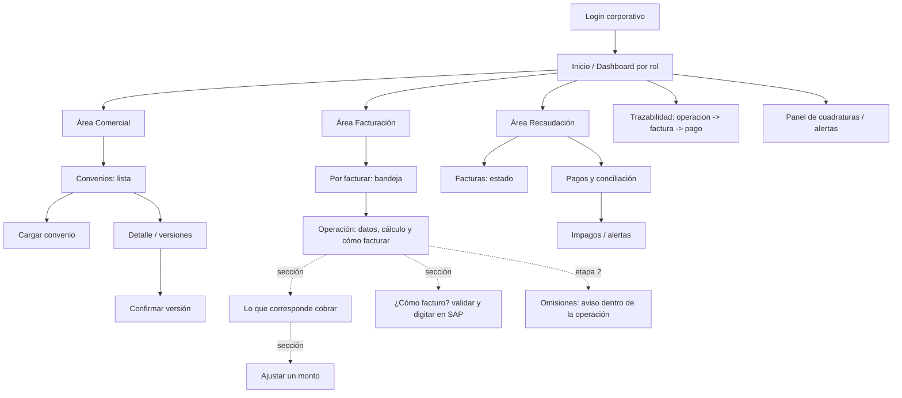

# Mapa de pantallas del frontend — ZARPE - FACTURACIÓN

Versión: 1.1
Fecha: 2026-11-13 (1.0: 2026-10-26)
Autor: Arquitecto de Solución (`arquitecto-satelite`)
Base: `requirements.md` (REQ-001…012), `api/openapi.yaml`, ADR-006/007/008/009/011/012, y la maqueta simple de la Fase A (`ux/maqueta-satelite-simple.html`, ver §4).
Propósito: definir las pantallas del frontend Angular, por rol, con su propósito, qué muestran y a qué endpoints de la API llaman. Es la guía para construir la UI. El modelo visual para presentación está en `diagramas/mapa-pantallas.svg`.

> **Cambios de la v1.1 (2026-11-13).** El módulo de operaciones se rediseñó según la maqueta simple. La bandeja se llama **"Por facturar"** (F1) y el detalle, el cálculo, el ajuste de monto, el agregado a mano y la validación pasan a ser **una sola pantalla: "Operación" (F2)**. F3, F4 y F6 siguen existiendo como **secciones** de esa pantalla, con los mismos nombres, para no romper las referencias de los ADR y de `tasks.md`. Las rutas `/ofa/:id` y `/ofa/:id/digitar` se retiraron.

> Tres áreas de usuario (REQ): **Comercial** (convenios), **Facturación** (operaciones, OFA, omisiones), **Recaudación** (pagos, conciliación). Todas sobre la misma API, con control de acceso por rol.

---

## 1. Navegación general

Menú lateral de la Fase A: **Por facturar**, **Convenios**, **Catálogo SAP** y **Configuración** (Terminales, Tipos de inspección).

---

## 2. Pantallas por rol

### 2.1 Área Comercial — Convenios (REQ-004, REQ-012; ADR-007/012)

| Pantalla | Propósito | Qué muestra | API |
|----------|-----------|-------------|-----|
| **C1 Convenios — lista** | Ver convenios por cliente y su vigencia | RUT, comercial, versión vigente, alertas de vencimiento | `GET /convenios` |
| **C2 Ingresar convenio** | Ingreso directo por formulario (reemplaza SharePoint) | Form: cliente y RUT, comercial, vigencia, moneda, tipo de cambio mínimo, días libres y tabla de servicios (tarifa, unidad, moneda) | `POST /convenios`, `POST /convenios/{id}/versiones` |
| **C3 Detalle / versiones** | Revisar la versión y el histórico de versiones | Servicios/tarifas/unidad/moneda, TC mínimo, días libres, vigencia, estado y origen de cada versión | `GET /convenios` |
| **C4 Confirmar versión** | Aprobar (humano) la versión para que quede VIGENTE | Resumen de la versión y diferencias con la vigente; botón confirmar | `POST /convenios/{id}/versiones/{v}/confirmar` |

Nota: toda versión nace en BORRADOR y solo una persona con rol la deja VIGENTE. Nunca se edita una versión vigente: cada cambio es una versión nueva. **Etapa opcional (IA):** si el negocio lo pide, C2 admite subir el documento y mostrar una propuesta extraída con su confianza; el flujo de confirmación (C4) es el mismo.

### 2.2 Área Facturación — Por facturar y Operación (REQ-001…008; ADR-006/008/009/011)

Dos pantallas, en la ruta `/operaciones` y `/operaciones/:id`. La persona de facturación hace una sola cosa: **ver cuánto corresponde cobrar por cada operación y comprobar que el cálculo está bien**.

| Pantalla | Propósito | Qué muestra | API |
|----------|-----------|-------------|-----|
| **F1 Por facturar** | Saber qué hay que mirar | Lista de operaciones que llegaron de AEXSA: operación, cliente (nombre y RUT), convenio, retiro, fecha de aprobación y **estado escrito**. Filtros "Todas / Con dato pendiente / Calculadas" y buscador por cliente u operación. Un clic (o Enter) abre la operación | `GET /operaciones` |
| **F2 Operación** | Ver cuánto se cobra y por qué, sin salir de la pantalla | Ver las secciones de abajo, en este orden | `GET /operaciones/{id}` y las de cada sección |

**Estados de la bandeja (siempre con texto, el color solo refuerza):** `Calculada`, `Validada`, `Sin calcular`, `Falta: <dato>` (con `(+N)` si faltan más), `Revisar: <decisión>`, `No facturable`, `Anulada`.

**Secciones de F2, de arriba hacia abajo:**

| Sección | Qué hace | API |
|---|---|---|
| **Encabezado** | Cliente, RUT y fecha de aprobación. Una línea fija dice **"Convenio encontrado: versión N (vigencia …)"** o **"Sin convenio para el RUT …: se cobra con tarifa pública."**, para que la persona detecte un convenio no cargado | — |
| **Aviso de lo que falta** | Solo aparece si hay pendientes abiertos y trae **solo los campos que faltan** (tipo de retiro, sentido, DUS, cantidad de un servicio, días bajo aforo, fecha de despacho, o una decisión). Pide un **motivo** y guarda; el cálculo se actualiza. Si falta el tipo de retiro, el cálculo no se muestra todavía. Los pendientes que no tienen campo (terminal sin grupo, inspección sin terminar) se explican en texto | `PATCH /operaciones/{id}` |
| **Datos de la operación** | Grilla de 4 columnas: documento, contenedor, terminal y su grupo, retiro, recepción, retiro del contenedor, días de almacenaje (con los bajo aforo), sentido, ruta en palabras, cuándo se factura, DIN, papeletas, consignatario y cliente facturador. Junto al retiro, **"Cambiar"**; arriba a la derecha, **"Corregir datos"** | — |
| **Corregir datos** | Tarjeta que se abre a pedido: tipo de retiro, sentido, DUS, contenedor, fecha de despacho y días bajo aforo, con motivo obligatorio. Recalcula; los servicios agregados a mano se conservan y los ajustes de monto hay que repetirlos. Solo mientras la OFA se puede recalcular | `PATCH /operaciones/{id}` |
| **F3 Lo que corresponde cobrar** | El resultado: líneas con servicio y artículo SAP, cantidad, tarifa, **"tarifa según"** (Convenio, Pública, Pública (excepción), Agregado a mano, Ajuste manual, Regla DP World en cero), monto en CLP y el **total grande**. Si la operación no tiene cálculo y puede calcularse, **el cálculo se hace al abrirla** (no hay paso "armar la OFA"). "Recalcular" queda como acción secundaria | `POST /operaciones/{id}/ofa`, `GET /ofa/{id}` |
| **¿Por qué?** (en F3) | Por línea, una frase en lenguaje común armada desde la memoria de cálculo ("15 días en total, menos 10 libres del convenio y menos 2 bajo aforo = 3 días a cobrar. Cuenta: 3 × 8.000 = 24.000 CLP"). El detalle técnico de la memoria va plegado debajo | `GET /ofa/{id}` |
| **F4 Ajustar** (en F3) | Por línea, dos campos en la misma fila: nuevo monto y motivo obligatorio. Registra autor, fecha y valor anterior | `POST /ofa/{id}/lineas/{l}/ajuste` |
| **Agregar un servicio que falta** (en F3) | Panel bajo la tabla: servicio del catálogo, cantidad, tarifa opcional (si queda vacía, la del convenio o la pública) y motivo. La línea queda "Agregado a mano" con quién, cuándo y por qué | `POST /ofa/{id}/lineas` |
| **F6 ¿Cómo facturo?** | Dos pasos en palabras: revisa los montos y valida. "Validar para digitar en SAP" lista lo que falta o deja la OFA `VALIDADA` con la tabla **"Lista para digitar en SAP"** (artículo, cantidad, precio, moneda, lista, en kit) y el kit sugerido. **"Enviar a SAP"** se ve pero está apagado, con la nota "Desactivado en esta etapa · se activa en la Fase B" | `POST /ofa/{id}/validar`, `POST /ofa/{id}/enviar` (responde 409 `ENVIO_SAP_DESHABILITADO`) |
| **Lo que informó AEXSA** | Sección plegada: contenedores con sus fechas e inspecciones, servicios prestados, pendientes ya resueltos y la versión recibida de AEXSA | — |

| Pantalla futura | Propósito | Qué muestra | API |
|----------|-----------|-------------|-----|
| **F5 Omisiones detectadas** (etapa 2, no construida) | Ver faltantes (prestado vs. valorizado) | Iría como un **aviso dentro de la operación**, no como pantalla propia. Lista de posibles omisiones (cruce determinístico; propuesta por IA como etapa opcional); decidir incluir/descartar | `GET /operaciones/{id}/omisiones` |

Nota: F3 es el corazón de la Entrega 2 (factura con valores ajustados). En la **Fase A**, F6 valida la OFA y la deja **lista para digitar en SAP** (con kit sugerido y lista de precios); el facturador la digita como hoy. En la **Fase B**, F6 envía a SAP de forma asíncrona (Outbox) y el folio vuelve por callback; el botón ya está en la pantalla, apagado. El alta manual de una operación (`POST /operaciones`) es el puente de la Fase A hasta que exista la ingesta real.

### 2.3 Área Recaudación — Facturas y pagos (REQ-009, REQ-010; ADR-004)

| Pantalla | Propósito | Qué muestra | API |
|----------|-----------|-------------|-----|
| **R1 Facturas — estado** | Ver facturas emitidas y su folio | Folio, tipo DTE, montos, operación, conciliada sí/no | `GET /facturas` |
| **R2 Pagos y conciliación** | Ver pagos y su asociación a facturas | Pago, pagador, folios cubiertos (agrupado), estado | `GET /pagos` |
| **R3 Impagos / alertas** | Seguir lo impago y vencido | Facturas con crédito vencido sin pago; saldos a favor/devoluciones | `GET /pagos?estado=PENDIENTE`, `GET /facturas` |

### 2.4 Transversal (todos los roles)

| Pantalla | Propósito | Qué muestra | API |
|----------|-----------|-------------|-----|
| **T1 Trazabilidad** | Reconstruir la cadena de una operación | operación → OFA → factura (folio) → pago; memoria de cálculo (el "por qué" del monto) | `GET /operaciones/{id}`, `GET /ofa/{id}`, `GET /facturas` |
| **T2 Panel de cuadraturas / alertas** | Monitoreo operativo | OFA sin folio (emitida-sin-confirmación), convenios por vencer, cola de Outbox, impagos | varios |
| **T4 Terminales** (Fase A, rol Administrador) | Asociar cada terminal de AEXSA con STI, DP World u otro | Los 7 terminales vistos, su grupo y cuántas operaciones esperan el mapeo | `GET /configuracion/terminales`, `PUT /configuracion/terminales/{id}` |
| **T5 Tipos de inspección** (Fase A, rol Administrador) | Asociar cada código de inspección de AEXSA con aforo de aduana, SAG u otra (los días bajo aforo no se cobran, RN-052) | Los códigos recibidos, su grupo y cuántas operaciones esperan el mapeo | `GET /configuracion/tipos-inspeccion`, `PUT /configuracion/tipos-inspeccion/{codigo}` |
| **T3 Catálogo SAP** (Fase A, ADR-017) | Consultar lo importado de SAP e importar | Kits y su composición, artículos y precios, vínculo servicio↔artículo (lo fija una persona; la sugerencia automática es opcional), tipo de cambio, versión y fecha del catálogo, e importación de los archivos A1 a A4 | `GET /catalogo`, `/catalogo/articulos`, `/catalogo/kits`, `/catalogo/tipo-cambio`, `/catalogo/vinculos`, `POST /catalogo/importaciones` |

Además, la sección F3 muestra el **kit SAP sugerido** (en F6) y marca por línea si está en el kit o se agrega a mano.

---

## 3. Principios de UI
- **Control de acceso por rol:** cada área visible solo para su perfil (comercial / facturación / recaudación); transversales según permiso.
- **El resultado va primero:** la operación muestra el total y las líneas sin pasos intermedios. No hay "armar la OFA".
- **Lo que falta se arregla ahí mismo:** el aviso trae solo los campos que faltan; no hay que salir a otra pantalla.
- **El "por qué" se abre solo si se pide:** cada línea tiene "¿Por qué?" con una frase en lenguaje común; el detalle técnico va plegado.
- **El estado nunca va solo por color:** cada estado y cada "tarifa según" lleva texto.
- **El humano confirma siempre:** las versiones de convenio (C4), las omisiones (F5), los vínculos de catálogo y los ajustes (F4) exigen acción humana y, cuando corresponde, un motivo. Si se activa la etapa opcional de IA, la IA solo propone, con su confianza visible, y nunca fija un monto.
- **Simple primero:** sin tarjetas de indicadores (KPI) en la primera versión. Bandejas de trabajo con filtros y detalle.
- **Auditabilidad visible:** la sección F3 muestra la memoria de cálculo; los ajustes (F4) y los datos corregidos exigen motivo y quedan registrados con autor y fecha.
- **Resiliencia visible:** el panel T2 refleja las cuadraturas obligatorias (operación↔OFA↔folio↔pago) y las alertas de integración.
- **Responsive y accesible:** navegación clara, etiquetas en los campos, foco visible y uso con teclado (la fila de la bandeja se abre con Enter). Validar con personas reales y con lector de pantalla sigue pendiente.

## 4. Modelo visual para presentación
Hay un diagrama visual de este mapa pensado para presentación (no técnico). No está en este repositorio.

La guía visual de **Por facturar** y **Operación** es la **maqueta simple de la Fase A**: `maqueta-satelite-simple.html` y su explicación `EXPLICACION-MAQUETA-SIMPLE.md`, junto con el logo de AEXSA. Viven en la carpeta `ux/ux` de trabajo, **fuera de este repositorio**; el equipo la aprobó el 2026-11-13 como la forma de construir y ver estas pantallas. Para el resto de la interfaz, usa el **prototipo navegable**, que se entrega por canal interno (ver `docs/desarrollo/GUIA-DESARROLLADOR.md`, sección "Qué recibes fuera del repositorio").
