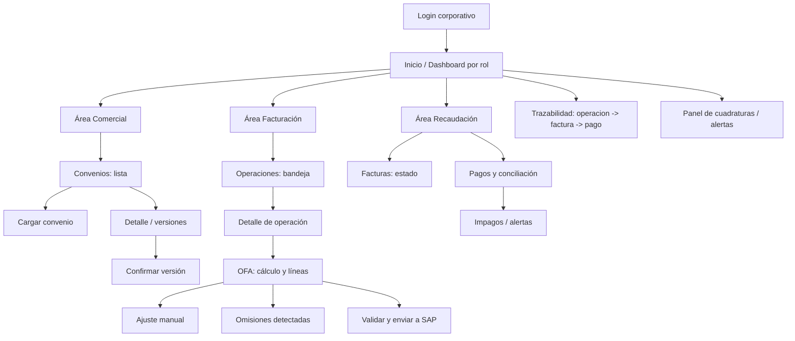

# Mapa de pantallas del frontend — Satélite de Facturación AEXSA

Versión: 1.0
Fecha: 2026-10-26
Autor: Arquitecto de Solución (`arquitecto-satelite`)
Base: `requirements.md` (REQ-001…012), `api/openapi.yaml`, ADR-006/007/008/009/011/012.
Propósito: definir las pantallas del frontend Angular, por rol, con su propósito, qué muestran y a qué endpoints de la API llaman. Es la guía para construir la UI. El modelo visual para presentación está en `diagramas/mapa-pantallas.svg`.

> Tres áreas de usuario (REQ): **Comercial** (convenios), **Facturación** (operaciones, OFA, omisiones), **Recaudación** (pagos, conciliación). Todas sobre la misma API, con control de acceso por rol.

---

## 1. Navegación general

---

## 2. Pantallas por rol

### 2.1 Área Comercial — Convenios (REQ-004, REQ-012; ADR-007/012)

| Pantalla | Propósito | Qué muestra | API |
|----------|-----------|-------------|-----|
| **C1 Convenios — lista** | Ver convenios por cliente y su vigencia | RUT, comercial, versión vigente, alertas de vencimiento | `GET /convenios` |
| **C2 Cargar convenio** | Carga directa del documento (reemplaza SharePoint) | Form: RUT, comercial, archivo PDF/Word; muestra propuesta extraída por IA | `POST /convenios` |
| **C3 Detalle / versiones** | Revisar la propuesta y el histórico de versiones | Servicios/tarifas/unidad/moneda, TC mínimo, días libres, vigencia; score de confianza IA | `GET /convenios` |
| **C4 Confirmar versión** | Aprobar (humano) la versión para que quede VIGENTE | Comparación propuesta vs. editado; botón confirmar | `POST /convenios/{id}/versiones/{v}/confirmar` |

Nota: la IA propone (BORRADOR); solo el humano deja VIGENTE. Nunca fija monto.

### 2.2 Área Facturación — Operaciones y OFA (REQ-001…008; ADR-006/008/009/011)

| Pantalla | Propósito | Qué muestra | API |
|----------|-----------|-------------|-----|
| **F1 Bandeja de operaciones** | Ver operaciones a facturar | Estado, cliente, ruta, pendientes/no facturables | `GET /operaciones` |
| **F2 Detalle de operación** | Revisar la operación y sus servicios | Ruta clasificada, DIN/DUS, destinatario(s), servicios prestados | `GET /operaciones/{id}` |
| **F3 OFA — cálculo y líneas** | Ver la prefactura valorizada (motor determinístico) | Líneas con cantidad/tarifa/moneda/monto, excepciones, destinatarios (repartido), memoria de cálculo | `POST /operaciones/{id}/ofa`, `GET /ofa/{id}` |
| **F4 Ajuste manual** | Ajustar un concepto no automatizado (auditable) | Form: nuevo monto + motivo obligatorio; registra autor/fecha/valor anterior | `POST /ofa/{id}/lineas/{l}/ajuste` |
| **F5 Omisiones detectadas** | Ver faltantes (prestado vs. valorizado) | Lista de posibles omisiones (cruce + propuesta IA); decidir incluir/descartar | `GET /operaciones/{id}/omisiones` |
| **F6 Validar y enviar** | Validar completitud y encolar a SAP | Resultado de validación (faltantes); envío asíncrono (Outbox) | `POST /ofa/{id}/validar`, `POST /ofa/{id}/enviar` |

Nota: F3 es el corazón de la Entrega 2 (factura con valores ajustados). El envío (F6) es asíncrono; el folio vuelve por callback.

### 2.3 Área Recaudación — Facturas y pagos (REQ-009, REQ-010; ADR-004)

| Pantalla | Propósito | Qué muestra | API |
|----------|-----------|-------------|-----|
| **R1 Facturas — estado** | Ver facturas emitidas y su folio | Folio, tipo DTE, montos, operación, conciliada sí/no | `GET /facturas` |
| **R2 Pagos y conciliación** | Ver pagos y su asociación a facturas | Pago, pagador, folios cubiertos (agrupado), estado | `GET /pagos` |
| **R3 Impagos / alertas** | Seguir lo impago y vencido | Facturas con crédito vencido sin pago; saldos a favor/devoluciones | `GET /pagos?estado=PENDIENTE`, `GET /facturas` |

### 2.4 Transversal (todos los roles)

| Pantalla | Propósito | Qué muestra | API |
|----------|-----------|-------------|-----|
| **T1 Trazabilidad** | Reconstruir la cadena de una operación | operación → OFA → factura (folio) → pago; memoria de cálculo (el "por qué" del monto) | `GET /operaciones/{id}`, `GET /ofa/{id}`, `GET /facturas` |
| **T2 Panel de cuadraturas / alertas** | Monitoreo operativo | OFA sin folio (emitida-sin-confirmación), convenios por vencer, cola de Outbox, impagos | varios |
| **T3 Catálogo SAP** (Fase A, ADR-017) | Consultar lo importado de SAP e importar | Kits y su composición, artículos y precios, vínculo servicio↔artículo (propuesta IA + confirmación), tipo de cambio, versión y fecha del catálogo | **por agregar a `openapi.yaml`** |

Además, la OFA (F3) muestra el **kit SAP sugerido y la lista de precios**, y marca por línea si está en el kit o se agrega a mano.

---

## 3. Principios de UI
- **Control de acceso por rol:** cada área visible solo para su perfil (comercial / facturación / recaudación); transversales según permiso.
- **La IA siempre propone, el humano confirma:** convenios (C4) y omisiones (F5) muestran la propuesta con su confianza y exigen acción humana.
- **Auditabilidad visible:** la pantalla de OFA (F3) muestra la memoria de cálculo; los ajustes (F4) exigen motivo.
- **Resiliencia visible:** el panel T2 refleja las cuadraturas obligatorias (operación↔OFA↔folio↔pago) y las alertas de integración.
- **Responsive y accesible:** navegación clara, foco en bandejas de trabajo (listas con filtros) y detalle.

## 4. Modelo visual para presentación
El diagrama visual de este mapa (pensado para mostrar en presentación, no técnico) está en `diagramas/mapa-pantallas.svg`. Muestra las tres áreas, sus pantallas y el flujo de navegación.
