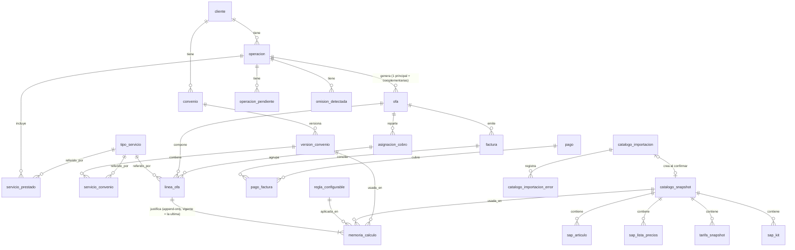

# Modelo de datos — ZARPE - FACTURACIÓN

Versión: 1.1
Fecha: 2026-11-05 (1.0: 2026-10-26)
Autor: Arquitecto de Solución (`arquitecto-satelite`)
Base: ADR-010 (modelo de datos, auditoría y trazabilidad), ADR-006/007/008/011, `design.md` §3.
Motor: **PostgreSQL** (estándar corporativo). Mapeo vía EF Core (ADR-001).
Propósito: especificar el **modelo físico** (tablas, columnas, tipos, claves, índices) que materializa el dominio. Es la base para la migración inicial de EF Core.

> **Cambios de la v1.1 (revisión del DBA, 2026-11-05).** Respuesta a los 11 vacíos detectados; cada cambio está marcado en el DDL con `-- [DBA-n]`.
>
> | N.º | Vacío | Decisión |
> |---|---|---|
> | 1 | `UNIQUE (operacion_id_aexsa, version)` impide registrar el `DUPLICADO` | Se quita el `UNIQUE` y se usa un **índice único parcial** solo sobre los mensajes `APLICADO`. Los repetidos y rechazados se insertan sin chocar |
> | 2 | Sin tabla para los artículos A1 | Nueva tabla `sap_articulo` por versión de catálogo |
> | 3 | Sin tabla para importaciones pendientes o rechazadas | Nuevas tablas `catalogo_importacion` y `catalogo_importacion_error` (un error por fila). Sirven para archivo (Fase A) y para la API (Fase B) |
> | 4 | `tarifa_snapshot` sin nombre de lista ni vigencias | Nueva tabla `sap_lista_precios` (código y nombre) y `vigente_desde` / `vigente_hasta` en `tarifa_snapshot` |
> | 5 | `linea_ofa` ↔ `memoria_calculo` dibujado 1 a 1 | Es **1 a muchos**: cada recálculo o ajuste agrega una fila. La vigente es la de mayor `calculado_en`. Se corrige el diagrama y se agrega índice |
> | 6 | `linea_ofa` sin columna de origen | Nueva columna `origen` (`CALCULADA`, `AGREGADA_MANUAL`, `REGLA_CONFIGURABLE`) y `en_kit_sap` |
> | 7 | ¿El recálculo es otra OFA o líneas nuevas? | **Misma OFA, líneas nuevas.** `ofa.version_calculo` sube; las líneas llevan su `version_calculo` y las anteriores se conservan. Una OFA **principal** por operación (índice único parcial); las **complementarias** son otras OFA (RN-056). `folio_idempotencia` se fija al encolar hacia SAP |
> | 8 | Pendientes y decisiones sin tabla | Nueva tabla `operacion_pendiente`: se calcula al ingresar o al cambiar datos y guarda la decisión del facturador. `CONVENIO_DISCREPANTE` ya no existe (el convenio lo determina ZARPE); se reemplaza por `VARIOS_CONVENIOS_VIGENTES` |
> | 9 | Enums distintos entre BD y API | Se alinean con el OpenAPI: origen del catálogo `ARCHIVO` / `API`; origen del vínculo `SUGERENCIA` / `MANUAL` |
> | 10 | Sin tablas para omisiones ni alertas | Nuevas tablas `omision_detectada` (con la decisión) y `alerta` |
> | 11 | `memoria_calculo.tarifa_snapshot_ver` y `tipo_cambio.fuente` sin FK ni CHECK | FK a `catalogo_snapshot(version)` y `CHECK (fuente IN ('API_SAP','ARCHIVO','MANUAL'))` |
>
> **Segunda revisión del DBA (2026-11-05).** Marcadas `-- [DBA-nb]`. Probadas con 22 casos que deben fallar o pasar (`DBA/probar_ddl.py`; detalle en `DBA/README.md`).
>
> | N.º | Observación | Corrección |
> |---|---|---|
> | 1b | Una versión más antigua podía aplicarse después de una más nueva | Algoritmo de ingesta explícito (sección 4b) y trigger `tr_operacion_version_no_retrocede`: `version_evento` nunca baja. La versión antigua queda `RECHAZADO` con `VERSION_SUPERADA` y AEXSA recibe `409` |
> | 3b / 4b | Una importación solo de listas creaba una versión sin artículos y la FK de `tarifa_snapshot` fallaba | Cada versión es **completa**: la importación parcial copia desde `base_version` lo que no vino. La primera versión exige artículos. `sap_kit_articulo` también queda con FK al artículo de su misma versión |
> | 6b | Faltaba exigir `agregada_por` en las líneas agregadas a mano | `CHECK ck_linea_agregada_manual`: una línea `AGREGADA_MANUAL` exige `agregada_por` y `motivo_agregada`; las demás no los llevan |
> | 8b | Faltaba exigir el motivo cuando la resolución es `DECISION` | `CHECK ck_pendiente_decision_con_motivo` y `ck_pendiente_resolucion_completa`. Mismo criterio aplicado a `omision_detectada` (descartar exige motivo) |
> | 10b | El índice de alertas permitía duplicados con `entidad_id` nulo | `NULLS NOT DISTINCT` (requiere PostgreSQL 15+; el estándar es RDS 16) |

> Principios aplicados: identidad de cliente por **RUT** (BR-020); versionado con vigencia en convenios/tarifas/reglas (un cálculo fija la versión usada); **auditoría append-only** (`memoria_calculo`, `evento_auditoria`); **folio** como clave de cuadratura operación↔OFA↔factura↔pago (RN-029, RNF-02).

---

## 1. Diagrama entidad-relación



---

## 2. Convenciones
- Nombres en `snake_case`, tablas en singular.
- Claves primarias **`uuid`** (`gen_random_uuid()`), salvo catálogos que conservan su clave natural de AEXSA.
- Montos: `numeric(18,4)`; moneda como `char(3)` (`CLP|USD|UF`). Tipo de cambio: `numeric(12,4)`.
- Fechas de evento/operación: `timestamptz`. Vigencias: `date`.
- Auditoría append-only: sin `UPDATE`/`DELETE`; un cambio inserta una fila nueva.
- Enums como `text` + `CHECK` (claridad y portabilidad) salvo que se opte por tipos enum nativos.

---

## 3. DDL (PostgreSQL)

### 3.1 Cliente y catálogo de servicios

```sql
-- Identidad por RUT (BR-020); mapeo a SAP (RN-065).
CREATE TABLE cliente (
    id              uuid PRIMARY KEY DEFAULT gen_random_uuid(),
    rut             varchar(12) NOT NULL UNIQUE,         -- identidad canonica
    razon_social    text NOT NULL,
    card_code_sap   varchar(30),                         -- socio de negocio SAP (PA-007)
    condicion_pago  text CHECK (condicion_pago IN ('CONTADO','CREDITO')), -- RN-065/020
    dias_credito    int,                                 -- 7/15/30 (RN-066)
    lista_precios_id varchar(30),                        -- lista de precios SAP
    creado_en       timestamptz NOT NULL DEFAULT now()
);

-- Catalogo normalizado desde MasterData.TipoServicio (192) (RN-032, BR-014).
CREATE TABLE tipo_servicio (
    tipo_servicio_id    int PRIMARY KEY,                 -- clave natural de AEXSA
    codigo              varchar(20) NOT NULL,
    descripcion         text NOT NULL,
    unidad_normalizada  text NOT NULL CHECK (unidad_normalizada IN
                         ('BL','DUS','CTR','CTR_DIA','TON','M3','CAMION','PALLET','UNIDAD')), -- BR-014/RN-048
    unidad_origen       text,                            -- texto crudo de AEXSA (referencia)
    habilitado          boolean NOT NULL DEFAULT true    -- solo Habilitado se factura (RN-032)
);
```

### 3.2 Convenios versionados (ADR-007)

```sql
CREATE TABLE convenio (
    id          uuid PRIMARY KEY DEFAULT gen_random_uuid(),
    cliente_id  uuid NOT NULL REFERENCES cliente(id),
    comercial   text,                                    -- RN-016
    creado_en   timestamptz NOT NULL DEFAULT now()
);

CREATE TABLE version_convenio (
    id              uuid PRIMARY KEY DEFAULT gen_random_uuid(),
    convenio_id     uuid NOT NULL REFERENCES convenio(id),
    numero          int NOT NULL,                        -- correlativo de version
    estado          text NOT NULL CHECK (estado IN ('BORRADOR','VIGENTE','VENCIDA','REEMPLAZADA')),
    vigencia_desde  date NOT NULL,
    vigencia_hasta  date,                                -- +1 año tipico (RN-021)
    tc_minimo       numeric(12,4),                       -- piso USD->CLP (RN-022)
    dias_libres     int,                                 -- almacenaje (RN-023)
    origen          text CHECK (origen IN ('IA_EXTRAIDO','MANUAL','COMPLEMENTO_CORREO')), -- RN-071/037
    documento_s3    text,                                -- PDF/Word origen en S3
    confirmado_por  text,                                -- confirmacion humana (RN-071)
    confirmado_en   timestamptz,
    creado_en       timestamptz NOT NULL DEFAULT now(),
    UNIQUE (convenio_id, numero)
);
CREATE INDEX ix_version_convenio_vigente
    ON version_convenio (convenio_id, estado, vigencia_desde);

CREATE TABLE servicio_convenio (
    id                  uuid PRIMARY KEY DEFAULT gen_random_uuid(),
    version_convenio_id uuid NOT NULL REFERENCES version_convenio(id),
    tipo_servicio_id    int  NOT NULL REFERENCES tipo_servicio(tipo_servicio_id),
    tarifa              numeric(18,4) NOT NULL,
    moneda              char(3) NOT NULL CHECK (moneda IN ('CLP','USD')), -- RN-022/036; UF no se cobra en convenios
    unidad              text NOT NULL                    -- RN-036; copiada del catalogo (tipo_servicio), no se digita
);
```

### 3.3 Operación y servicios prestados (ADR-005/010/011)

```sql
CREATE TABLE operacion (
    id                  uuid PRIMARY KEY DEFAULT gen_random_uuid(),
    operacion_id_aexsa  varchar(40) NOT NULL UNIQUE,     -- idempotencia de ingesta (SolicitudVisadoID de AEXSA, como texto)
    documento_carga_id  varchar(40) NOT NULL,            -- 1,9 % de los documentos tiene mas de una solicitud: evita facturar dos veces
    cliente_id          uuid REFERENCES cliente(id),
    tipo_carga          text CHECK (tipo_carga IN ('CONTENEDOR','BULTO')),       -- RN-027
    sentido             text CHECK (sentido IN ('IMPORTACION','EXPORTACION')),   -- impo usa DIN, expo usa DUS (RN-047)
    tipo_retiro         text CHECK (tipo_retiro IN ('DIRECTO','INDIRECTO')),     -- RN-026
    con_convenio        boolean NOT NULL DEFAULT false,  -- lo determina ZARPE al buscar el convenio vigente por RUT y fecha; no viene de AEXSA
    version_convenio_id uuid REFERENCES version_convenio(id), -- convenio encontrado (null = sin convenio, tarifa publica)
    puerto              text,                            -- heredado; usar terminal
    din                 varchar(40),                     -- declaracion import
    dus                 text[],                          -- declaraciones de salida (expo); BL<->DUS 1:N
    bls                 text[],                          -- una factura puede agrupar varios BL (RN-055)
    cantidad_dus        int,                             -- driver de cobro expo; CAPTURA MANUAL (RN-047, adenda A2)
    terminal_aexsa_id   int,                             -- id en MasterData.TerminalRetiro de AEXSA (hay 7)
    terminal_aexsa_nombre text,
    terminal_grupo      text CHECK (terminal_grupo IN ('STI','DP_WORLD','OTRO','SIN_MAPEAR')), -- resuelto con terminal_mapa; gobierna la refacturacion del directo (RN-079, ADR-015)
    estado_operacion    text NOT NULL DEFAULT 'ACTIVA' CHECK (estado_operacion IN ('ACTIVA','ANULADA')),
    papeleta_numero     varchar(40),                     -- para contrastar con la DIN (RN-001)
    papeleta_rut        varchar(12),
    consignatario_id    uuid REFERENCES cliente(id),     -- RUT de la declaracion (RN-057)
    cliente_facturador_id uuid REFERENCES cliente(id),   -- quien indico AEXSA; null = usar consignatario (RN-077)
    tipo_cliente_facturador text CHECK (tipo_cliente_facturador IN ('EMISOR_BL','CLIENTE','GENERADOR_NEGOCIO','CONSIGNATARIO')),
    facturador_asignado_por varchar(80),
    facturador_asignado_en  timestamptz,
    ruta_clasificada    text,                            -- {carga}x{retiro}x{convenio} (REQ-002)
    momento_facturacion text CHECK (momento_facturacion IN ('EN_VISACION','POST_DESPACHO')), -- RN-046
    facturable          boolean NOT NULL DEFAULT true,   -- false si DIN<>papeleta (RN-001)
    visado_aprobado_en  timestamptz,                     -- del evento de AEXSA
    version_evento      int NOT NULL DEFAULT 1,          -- ultima version recibida; actualiza, no duplica
    ingerido_en         timestamptz NOT NULL DEFAULT now(),
    actualizado_en      timestamptz NOT NULL DEFAULT now()
);
CREATE INDEX ix_operacion_cliente ON operacion (cliente_id);

-- [DBA-1b] La version aplicada nunca retrocede: una version mas antigua que llega tarde no puede pisar a una mas nueva.
-- Respaldo en la base de la regla de ingesta (ver "Algoritmo de ingesta" en la seccion 5).
CREATE FUNCTION operacion_version_no_retrocede() RETURNS trigger LANGUAGE plpgsql AS $$
BEGIN
    IF NEW.version_evento < OLD.version_evento THEN
        RAISE EXCEPTION 'version_evento no puede retroceder (% -> %)', OLD.version_evento, NEW.version_evento
            USING ERRCODE = 'check_violation';
    END IF;
    RETURN NEW;
END $$;
CREATE TRIGGER tr_operacion_version_no_retrocede
    BEFORE UPDATE OF version_evento ON operacion
    FOR EACH ROW EXECUTE FUNCTION operacion_version_no_retrocede();
CREATE INDEX ix_operacion_documento ON operacion (documento_carga_id);

-- Contenedores de la operacion: almacenaje, despacho, aforo e inspecciones (RN-033/046/052/058).
CREATE TABLE contenedor_operacion (
    id                uuid PRIMARY KEY DEFAULT gen_random_uuid(),
    operacion_id      uuid NOT NULL REFERENCES operacion(id),
    numero            varchar(15) NOT NULL,
    fecha_recepcion   timestamptz,
    fecha_retiro      timestamptz,
    fecha_despacho    timestamptz,                       -- con convenio se factura tras el despacho, tope 7 dias (RN-046)
    dias_almacenaje   int,                               -- lo calcula AEXSA (RN-033); no descuenta dias libres
    aforo_asignado_en timestamptz,                       -- AEXSA solo guarda cuando se asigno el aforo
    dias_bajo_aforo   int,                               -- puede venir vacio; lo completa el facturador (auditable) (RN-052)
    aforo_finalizado_en timestamptz,
    es_reefer         boolean NOT NULL DEFAULT false,
    inspecciones      jsonb,                             -- [{tipo, finalizadaEn}] (RN-054/058)
    UNIQUE (operacion_id, numero)
);

CREATE TABLE servicio_prestado (
    id               uuid PRIMARY KEY DEFAULT gen_random_uuid(),
    operacion_id     uuid NOT NULL REFERENCES operacion(id),
    tipo_servicio_id int  NOT NULL REFERENCES tipo_servicio(tipo_servicio_id),
    cantidad         numeric(18,4),                      -- NULL = pendiente: AEXSA puede enviarla vacia; sin cantidad no se valoriza
    unidad           text NOT NULL,                      -- normalizada por el Satelite desde tipo_servicio (no el texto de AEXSA)
    contenedor       varchar(15),                        -- contenedor al que corresponde, si aplica
    finalizado_en    timestamptz,
    origen_dato      text CHECK (origen_dato IN ('AEXSA','LIQUIDACION_PUERTO'))  -- cargos de puerto tardios (RN-056)
);
CREATE INDEX ix_servicio_prestado_op ON servicio_prestado (operacion_id);

-- Registro de cada mensaje recibido de AEXSA SYS (auditoria y reproceso; ADR-005). Append-only.
CREATE TABLE evento_aexsa (
    id                  uuid PRIMARY KEY DEFAULT gen_random_uuid(),
    operacion_id_aexsa  varchar(40) NOT NULL,
    version             int NOT NULL,
    tipo_evento         text NOT NULL CHECK (tipo_evento IN ('VISADO_APROBADO','OPERACION_ACTUALIZADA')),
    recibido_en         timestamptz NOT NULL DEFAULT now(),
    carga               jsonb NOT NULL,                  -- el mensaje tal como llego
    resultado           text NOT NULL CHECK (resultado IN ('APLICADO','DUPLICADO','RECHAZADO')),
    detalle_error       text
);
-- [DBA-1] Solo una version APLICADA por operacion; los DUPLICADO y RECHAZADO se registran sin chocar.
CREATE UNIQUE INDEX ux_evento_aexsa_aplicado
    ON evento_aexsa (operacion_id_aexsa, version) WHERE resultado = 'APLICADO';
CREATE INDEX ix_evento_aexsa_operacion ON evento_aexsa (operacion_id_aexsa, recibido_en);

-- [DBA-8] Pendientes de la operacion y decision del facturador. Se recalculan al ingresar o al cambiar datos;
-- un pendiente resuelto no se borra (queda la decision). Abierto = resuelto_en IS NULL.
CREATE TABLE operacion_pendiente (
    id             uuid PRIMARY KEY DEFAULT gen_random_uuid(),
    operacion_id   uuid NOT NULL REFERENCES operacion(id),
    tipo           text NOT NULL CHECK (tipo IN ('TIPO_RETIRO','SENTIDO','TERMINAL_SIN_MAPEAR','CANTIDAD_DUS',
                       'CANTIDAD_SERVICIO','DIAS_AFORO','FECHA_DESPACHO','VARIOS_CONVENIOS_VIGENTES',
                       'DOCUMENTO_CON_VARIAS_SOLICITUDES')),     -- mismos valores que el OpenAPI
    bloquea_validacion boolean NOT NULL,                       -- true si afecta el monto (tarea 3.1a)
    detalle        jsonb,                                      -- p.ej. convenios candidatos, otra operacion del mismo documento
    detectado_en   timestamptz NOT NULL DEFAULT now(),
    resuelto_en    timestamptz,
    resuelto_por   varchar(120),
    resolucion     text CHECK (resolucion IN ('DATO_COMPLETADO','DECISION','YA_NO_APLICA')),
    decision       jsonb,                                      -- p.ej. {convenioElegido} o {operacionValida}
    motivo         text,                                       -- obligatorio si resolucion = DECISION
    -- [DBA-8b] Resolver es todo o nada: fecha, usuario y tipo de resolucion van juntos.
    CONSTRAINT ck_pendiente_resolucion_completa CHECK (
        (resuelto_en IS NULL AND resuelto_por IS NULL AND resolucion IS NULL)
     OR (resuelto_en IS NOT NULL AND resuelto_por IS NOT NULL AND resolucion IS NOT NULL)),
    -- [DBA-8b] Una DECISION exige motivo no vacio y la decision tomada.
    CONSTRAINT ck_pendiente_decision_con_motivo CHECK (
        resolucion IS DISTINCT FROM 'DECISION'
     OR (decision IS NOT NULL AND motivo IS NOT NULL AND btrim(motivo) <> ''))
);
CREATE UNIQUE INDEX ux_pendiente_abierto
    ON operacion_pendiente (operacion_id, tipo) WHERE resuelto_en IS NULL;

-- Mapeo de terminales de AEXSA (7) a los grupos que usa la regla del directo (RN-079). Lo mantiene el Administrador.
CREATE TABLE terminal_mapa (
    terminal_aexsa_id int PRIMARY KEY,
    nombre            text NOT NULL,
    grupo             text NOT NULL DEFAULT 'SIN_MAPEAR' CHECK (grupo IN ('STI','DP_WORLD','OTRO','SIN_MAPEAR')),
    actualizado_por   varchar(80),
    actualizado_en    timestamptz NOT NULL DEFAULT now()
);
```

### 3.3b Catálogo SAP importado (ADR-017)

```sql
-- [DBA-3] Cada intento de carga del catalogo (archivo en Fase A puente, API en Fase B), antes de confirmarse.
CREATE TABLE catalogo_importacion (
    id              uuid PRIMARY KEY DEFAULT gen_random_uuid(),
    origen          text NOT NULL CHECK (origen IN ('ARCHIVO','API')),        -- [DBA-9] alineado con el OpenAPI
    tipo            text NOT NULL CHECK (tipo IN ('ARTICULOS','LISTAS_PRECIOS','KITS','TIPO_CAMBIO','SOCIOS_NEGOCIO','COMPLETO')),
    archivo_s3      text,                                -- solo si origen = ARCHIVO
    hash_contenido  char(64),                            -- SHA-256; avisa si se carga dos veces lo mismo
    filas_leidas    int NOT NULL DEFAULT 0,
    filas_validas   int NOT NULL DEFAULT 0,
    estado          text NOT NULL CHECK (estado IN ('PENDIENTE_CONFIRMACION','RECHAZADA','CONFIRMADA')),
    cargado_por     varchar(120) NOT NULL,
    cargado_en      timestamptz NOT NULL DEFAULT now(),
    resuelto_por    varchar(120),                        -- quien confirmo o rechazo
    resuelto_en     timestamptz,
    snapshot_version int                                 -- version creada al confirmar (FK abajo)
);

CREATE TABLE catalogo_importacion_error (
    id              bigserial PRIMARY KEY,
    importacion_id  uuid NOT NULL REFERENCES catalogo_importacion(id),
    fila            int,                                 -- null si el error es del archivo completo
    columna         varchar(60),
    codigo          varchar(40) NOT NULL,                -- p.ej. DUPLICADO, ARTICULO_INACTIVO, FORMATO
    mensaje         text NOT NULL
);
CREATE INDEX ix_importacion_error ON catalogo_importacion_error (importacion_id);

-- Version confirmada y activa del catalogo. Solo nace al confirmar una importacion.
CREATE TABLE catalogo_snapshot (
    version         int PRIMARY KEY,
    fecha           timestamptz NOT NULL DEFAULT now(),
    origen          text NOT NULL CHECK (origen IN ('ARCHIVO','API')),        -- [DBA-9]
    importacion_id  uuid NOT NULL UNIQUE REFERENCES catalogo_importacion(id),
    base_version    int REFERENCES catalogo_snapshot(version), -- [DBA-3b] version de la que se copiaron los recursos no importados
    confirmado_por  varchar(120) NOT NULL,               -- confirmacion humana antes de activar
    confirmado_en   timestamptz NOT NULL,
    CONSTRAINT ck_snapshot_base_anterior CHECK (base_version IS NULL OR base_version < version)
);
-- [DBA-3b] Cada version es COMPLETA. Al confirmar una importacion parcial (p.ej. solo LISTAS_PRECIOS), la version
-- nueva copia de base_version (la vigente) los recursos que no vinieron: articulos, listas, kits. Asi las FK de
-- tarifa_snapshot y sap_kit_articulo siempre encuentran sus articulos en la misma version.
-- La primera version (base_version null) debe venir de una importacion COMPLETO o ARTICULOS (regla de aplicacion).
ALTER TABLE catalogo_importacion
    ADD CONSTRAINT fk_importacion_snapshot FOREIGN KEY (snapshot_version) REFERENCES catalogo_snapshot(version);

-- [DBA-2] Articulos de servicio de SAP (archivo A1 / API-1 recurso 1.1), por version.
CREATE TABLE sap_articulo (
    snapshot_version int NOT NULL REFERENCES catalogo_snapshot(version),
    codigo           varchar(40) NOT NULL,
    descripcion      text NOT NULL,
    unidad_medida    varchar(20) NOT NULL,
    activo           boolean NOT NULL,
    grupo            varchar(60),
    PRIMARY KEY (snapshot_version, codigo)
);

-- [DBA-4] Encabezado de las listas de precios (archivo A2 / API-1 recurso 1.2), por version.
CREATE TABLE sap_lista_precios (
    snapshot_version int NOT NULL REFERENCES catalogo_snapshot(version),
    codigo           varchar(30) NOT NULL,
    nombre           text NOT NULL,
    es_publica       boolean NOT NULL DEFAULT false,     -- la lista "spot" (RN-014)
    PRIMARY KEY (snapshot_version, codigo)
);

-- Kits de SAP: encabezado y composicion (RN-061). Referencia, no entrada del calculo.
CREATE TABLE sap_kit (
    id               uuid PRIMARY KEY DEFAULT gen_random_uuid(),
    snapshot_version int  NOT NULL REFERENCES catalogo_snapshot(version),
    kit_codigo       varchar(40) NOT NULL,
    nombre           text NOT NULL,
    ruta             text,                               -- ruta a la que aplica (directo, indirecto sin convenio, con convenio...)
    UNIQUE (snapshot_version, kit_codigo),
    UNIQUE (id, snapshot_version)                        -- para que la composicion use la misma version
);

CREATE TABLE sap_kit_articulo (
    kit_id           uuid NOT NULL,
    snapshot_version int  NOT NULL,                      -- [DBA-3b] misma version que el kit
    articulo_id      varchar(40) NOT NULL,
    cantidad         numeric(18,4) NOT NULL DEFAULT 1 CHECK (cantidad > 0),
    PRIMARY KEY (kit_id, articulo_id),
    FOREIGN KEY (kit_id, snapshot_version) REFERENCES sap_kit(id, snapshot_version),
    FOREIGN KEY (snapshot_version, articulo_id) REFERENCES sap_articulo(snapshot_version, codigo)
);

-- Vinculo servicio del Satelite <-> articulo SAP (sugerencia opcional + confirmacion humana).
CREATE TABLE servicio_articulo_sap (
    tipo_servicio_id int NOT NULL REFERENCES tipo_servicio(tipo_servicio_id),
    articulo_id      varchar(40) NOT NULL,
    origen           text NOT NULL CHECK (origen IN ('SUGERENCIA','MANUAL')),   -- [DBA-9] alineado con el OpenAPI
    confirmado_por   text,
    confirmado_en    timestamptz,
    PRIMARY KEY (tipo_servicio_id, articulo_id)
);

-- Tipo de cambio diario que usa el motor (RN-022). Preferente: el mismo que usa SAP al emitir.
CREATE TABLE tipo_cambio (
    fecha        date NOT NULL,
    moneda       char(3) NOT NULL CHECK (moneda IN ('USD','UF')),
    valor        numeric(12,4) NOT NULL,
    fuente       text NOT NULL CHECK (fuente IN ('API_SAP','ARCHIVO','MANUAL')),   -- [DBA-11]
    importacion_id uuid REFERENCES catalogo_importacion(id),  -- si vino de archivo o API
    cargado_por  text NOT NULL,
    PRIMARY KEY (fecha, moneda)
);
```

### 3.4 Tarifas de SAP (snapshot versionado, ADR-003)

```sql
CREATE TABLE tarifa_snapshot (
    id               uuid PRIMARY KEY DEFAULT gen_random_uuid(),
    version          int NOT NULL REFERENCES catalogo_snapshot(version), -- version del snapshot
    fecha            timestamptz NOT NULL DEFAULT now(),
    articulo_id      varchar(40) NOT NULL,               -- articulo SAP
    lista_precios_id varchar(30) NOT NULL,
    precio           numeric(18,4) NOT NULL,
    moneda           char(3) NOT NULL CHECK (moneda IN ('CLP','USD','UF')),
    vigente_desde    date NOT NULL,                      -- [DBA-4]
    vigente_hasta    date,                               -- [DBA-4]
    UNIQUE (version, articulo_id, lista_precios_id, vigente_desde),
    FOREIGN KEY (version, articulo_id) REFERENCES sap_articulo(snapshot_version, codigo),
    FOREIGN KEY (version, lista_precios_id) REFERENCES sap_lista_precios(snapshot_version, codigo)
);
```

### 3.5 Reglas configurables (ADR-008)

```sql
CREATE TABLE regla_configurable (
    id              uuid PRIMARY KEY DEFAULT gen_random_uuid(),
    nombre          text NOT NULL,
    condicion       jsonb NOT NULL,                      -- p.ej. {forwarder, puerto, concepto}
    accion          jsonb NOT NULL,                      -- agregar/poner_cero/aplicar_factor
    version         int NOT NULL,
    vigencia_desde  date NOT NULL,
    vigencia_hasta  date,
    creado_por      text NOT NULL,
    creado_en       timestamptz NOT NULL DEFAULT now()
);
```

### 3.6 OFA, líneas y repartido (ADR-010/011)

```sql
-- [DBA-7] Un recalculo NO crea otra OFA: sube version_calculo e inserta lineas nuevas con esa version.
-- Las lineas de versiones anteriores se conservan (historico). Solo se recalcula en BORRADOR o VALIDADA.
CREATE TABLE ofa (
    id                  uuid PRIMARY KEY DEFAULT gen_random_uuid(),
    operacion_id        uuid NOT NULL REFERENCES operacion(id),
    tipo                text NOT NULL DEFAULT 'PRINCIPAL' CHECK (tipo IN ('PRINCIPAL','COMPLEMENTARIA')), -- complementaria tardia (RN-056)
    estado              text NOT NULL CHECK (estado IN
                         ('BORRADOR','VALIDADA','ENVIADA','EMITIDA',
                          'EMITIDA_SIN_CONFIRMACION','CONCILIADA','INFORMADA_AEXSA')),   -- RNF-07; INFORMADA_AEXSA = AEXSA acuso recibo (ADR-004)
    version_calculo     int NOT NULL DEFAULT 1,           -- version vigente de las lineas
    folio_idempotencia  varchar(80) UNIQUE,               -- OfaId+version_calculo; se fija al encolar hacia SAP (ADR-002)
    fecha_calculo       timestamptz NOT NULL DEFAULT now()
);
CREATE INDEX ix_ofa_operacion ON ofa (operacion_id);
CREATE UNIQUE INDEX ux_ofa_principal ON ofa (operacion_id) WHERE tipo = 'PRINCIPAL';
CREATE INDEX ix_ofa_estado    ON ofa (estado);

-- Repartido: varios destinatarios por operacion (RN-050/077).
CREATE TABLE asignacion_cobro (
    id               uuid PRIMARY KEY DEFAULT gen_random_uuid(),
    ofa_id           uuid NOT NULL REFERENCES ofa(id),
    destinatario_rut varchar(12) NOT NULL,                -- RUT de la DIN/DUS (RN-057)
    rol              text CHECK (rol IN ('CONSIGNATARIO','FORWARDER','EMBARCADOR')), -- RN-050
    origen_instruccion text                               -- correo/default (BR-024)
);

CREATE TABLE linea_ofa (
    id                  uuid PRIMARY KEY DEFAULT gen_random_uuid(),
    ofa_id              uuid NOT NULL REFERENCES ofa(id),
    asignacion_cobro_id uuid REFERENCES asignacion_cobro(id),   -- a quien se cobra esta linea
    tipo_servicio_id    int  NOT NULL REFERENCES tipo_servicio(tipo_servicio_id),
    articulo_sap_id     varchar(40),                       -- codigo SAP vigente al calcular (ADR-017); NULL = sin articulo, no enviable
    cantidad            numeric(18,4) NOT NULL,
    unidad              text NOT NULL,
    tarifa              numeric(18,4) NOT NULL,
    moneda              char(3) NOT NULL CHECK (moneda IN ('CLP','USD','UF')),
    monto               numeric(18,4) NOT NULL,            -- en CLP tras conversion
    es_excepcion        boolean NOT NULL DEFAULT false,    -- tarifa publica sin convenio (RN-006)
    version_calculo     int NOT NULL,                      -- [DBA-7] version de calculo a la que pertenece la linea
    origen              text NOT NULL DEFAULT 'CALCULADA'
                         CHECK (origen IN ('CALCULADA','AGREGADA_MANUAL','REGLA_CONFIGURABLE')), -- [DBA-6]
    en_kit_sap          boolean,                           -- [DBA-6] esta en el kit sugerido (ADR-017); null si no hay kit
    agregada_por        varchar(120),                      -- [DBA-6] solo si origen = AGREGADA_MANUAL
    motivo_agregada     text,                              -- [DBA-6b] motivo obligatorio del agregado manual (POST /ofa/{id}/lineas)
    linea_origen_id     uuid REFERENCES linea_ofa(id),     -- linea de la version anterior que esta reemplaza (trazabilidad del recalculo)
    -- [DBA-6b] Una linea agregada a mano lleva quien y por que; las demas no llevan esos datos.
    CONSTRAINT ck_linea_agregada_manual CHECK (
        (origen = 'AGREGADA_MANUAL' AND agregada_por IS NOT NULL AND btrim(agregada_por) <> ''
                                    AND motivo_agregada IS NOT NULL AND btrim(motivo_agregada) <> '')
     OR (origen <> 'AGREGADA_MANUAL' AND agregada_por IS NULL AND motivo_agregada IS NULL))
);
CREATE INDEX ix_linea_ofa_ofa ON linea_ofa (ofa_id, version_calculo);
CREATE INDEX ix_linea_ofa_origen ON linea_ofa (ofa_id, origen);
-- Lineas vigentes de una OFA: linea_ofa.version_calculo = ofa.version_calculo.
-- Al recalcular, las lineas AGREGADA_MANUAL se copian a la version nueva (con linea_origen_id); los ajustes de monto no.
```

### 3.7 Memoria de cálculo (append-only, ADR-006/010)

```sql
-- Reconstruccion del "por que" de cada monto (REQ-011, RNF-01). NO se actualiza ni borra.
CREATE TABLE memoria_calculo (
    id                  uuid PRIMARY KEY DEFAULT gen_random_uuid(),
    linea_ofa_id        uuid NOT NULL REFERENCES linea_ofa(id),
    reglas_aplicadas    jsonb NOT NULL,                   -- [{regla, version}]
    version_convenio_id uuid REFERENCES version_convenio(id),
    tarifa_snapshot_ver int REFERENCES catalogo_snapshot(version), -- [DBA-11] version del catalogo usada
    tipo_cambio         numeric(12,4),                    -- TC del dia aplicado (RN-022)
    regla_config_id     uuid REFERENCES regla_configurable(id),
    ajuste_manual       jsonb,                            -- {usuario,fecha,motivo,valor_ant,valor_nuevo} (REQ-006)
    calculado_en        timestamptz NOT NULL DEFAULT now()
);
-- [DBA-5] Una linea tiene 1..N memorias (calculo inicial + cada ajuste). La vigente es la mas reciente.
CREATE INDEX ix_memoria_linea ON memoria_calculo (linea_ofa_id, calculado_en DESC);
```

### 3.7b Omisiones y alertas (ADR-009, RNF-07)

```sql
-- [DBA-10] Faltantes detectados (prestado vs. valorizado) y la decision del facturador (REQ-007, RN-068).
CREATE TABLE omision_detectada (
    id               uuid PRIMARY KEY DEFAULT gen_random_uuid(),
    operacion_id     uuid NOT NULL REFERENCES operacion(id),
    ofa_id           uuid REFERENCES ofa(id),
    tipo_servicio_id int REFERENCES tipo_servicio(tipo_servicio_id),
    descripcion      text NOT NULL,
    origen           text NOT NULL CHECK (origen IN ('CRUCE_DETERMINISTICO','PROPUESTA_IA')), -- igual que el OpenAPI
    confianza        numeric(5,4),                       -- solo si PROPUESTA_IA (etapa opcional)
    detectada_en     timestamptz NOT NULL DEFAULT now(),
    decision         text CHECK (decision IN ('INCLUIDA','DESCARTADA','COMPLEMENTARIA')), -- null = sin decidir
    motivo           text,                               -- obligatorio si DESCARTADA
    decidida_por     varchar(120),
    decidida_en      timestamptz,
    linea_ofa_id     uuid REFERENCES linea_ofa(id),      -- linea creada si se incluyo
    -- Mismo criterio que operacion_pendiente: decidir es todo o nada, y descartar exige motivo.
    CONSTRAINT ck_omision_decision_completa CHECK (
        (decision IS NULL AND decidida_por IS NULL AND decidida_en IS NULL)
     OR (decision IS NOT NULL AND decidida_por IS NOT NULL AND decidida_en IS NOT NULL)),
    CONSTRAINT ck_omision_descarte_con_motivo CHECK (
        decision IS DISTINCT FROM 'DESCARTADA' OR (motivo IS NOT NULL AND btrim(motivo) <> ''))
);
CREATE INDEX ix_omision_operacion ON omision_detectada (operacion_id);
CREATE INDEX ix_omision_sin_decidir ON omision_detectada (operacion_id) WHERE decision IS NULL;

-- [DBA-10] Alertas operativas. Se cierran, no se borran.
CREATE TABLE alerta (
    id             uuid PRIMARY KEY DEFAULT gen_random_uuid(),
    tipo           text NOT NULL CHECK (tipo IN ('CONVENIO_POR_VENCER','ANULACION_CON_OFA_ENVIADA',
                       'COMPLEMENTARIA_TARDIA','EMITIDA_SIN_CONFIRMACION','RETORNO_AEXSA_FALLIDO',
                       'IMPAGO','CATALOGO_DESACTUALIZADO')),
    entidad        text NOT NULL,                        -- operacion | ofa | version_convenio | factura | catalogo
    entidad_id     uuid,
    detalle        jsonb,
    estado         text NOT NULL DEFAULT 'ABIERTA' CHECK (estado IN ('ABIERTA','ATENDIDA','DESCARTADA')),
    creada_en      timestamptz NOT NULL DEFAULT now(),
    atendida_por   varchar(120),
    atendida_en    timestamptz,
    comentario     text
);
CREATE INDEX ix_alerta_abierta ON alerta (tipo, creada_en) WHERE estado = 'ABIERTA';
-- [DBA-10b] NULLS NOT DISTINCT (PostgreSQL 15+): dos alertas abiertas del mismo tipo sin entidad_id (p.ej.
-- CATALOGO_DESACTUALIZADO) cuentan como repetidas. Sin esto, PostgreSQL trata cada NULL como distinto.
CREATE UNIQUE INDEX ux_alerta_abierta_entidad ON alerta (tipo, entidad, entidad_id) NULLS NOT DISTINCT
    WHERE estado = 'ABIERTA';
```

### 3.8 Factura y pago (ADR-004/010)

```sql
CREATE TABLE factura (
    id           uuid PRIMARY KEY DEFAULT gen_random_uuid(),
    ofa_id       uuid NOT NULL REFERENCES ofa(id),
    folio        varchar(40) NOT NULL UNIQUE,             -- clave de cuadratura (RN-029)
    tipo_dte     int NOT NULL,                            -- 33/34/52/56/61/110/111/112 (RN-034)
    monto_neto   numeric(18,4),
    monto_total  numeric(18,4),
    moneda       char(3) NOT NULL DEFAULT 'CLP',
    dte_xml_s3   text,                                    -- XML del DTE en S3 (RN-076)
    emitida_en   timestamptz,
    conciliada   boolean NOT NULL DEFAULT false
);
CREATE INDEX ix_factura_ofa ON factura (ofa_id);

CREATE TABLE pago (
    id               uuid PRIMARY KEY DEFAULT gen_random_uuid(),
    referencia_sap   varchar(40),                         -- Pago Recibido (PR) en SAP (RN-063)
    pagador_rut      varchar(12),                         -- quien efectuo el pago (RN-069)
    monto            numeric(18,4) NOT NULL,
    fecha_pago       date,
    estado           text CHECK (estado IN ('PAGADA','PENDIENTE','PARCIAL')),
    registrado_en    timestamptz NOT NULL DEFAULT now()
);

-- Un pago agrupa varias facturas / varios clientes (RN-067).
CREATE TABLE pago_factura (
    pago_id      uuid NOT NULL REFERENCES pago(id),
    factura_id   uuid NOT NULL REFERENCES factura(id),
    monto_aplicado numeric(18,4) NOT NULL,
    PRIMARY KEY (pago_id, factura_id)
);
```

### 3.9 Auditoría e integración

```sql
-- Log transversal append-only (quien, cuando, que) (RNF-01).
CREATE TABLE evento_auditoria (
    id            bigserial PRIMARY KEY,
    entidad       text NOT NULL,                          -- tabla/agregado afectado
    entidad_id    uuid,
    accion        text NOT NULL,
    usuario       text NOT NULL,
    valor_anterior jsonb,
    valor_nuevo   jsonb,
    ocurrido_en   timestamptz NOT NULL DEFAULT now()
);
CREATE INDEX ix_auditoria_entidad ON evento_auditoria (entidad, entidad_id);
CREATE INDEX ix_auditoria_fecha   ON evento_auditoria (ocurrido_en);

-- Outbox transaccional para escritura hacia SAP (ADR-002).
CREATE TABLE outbox_message (
    id            uuid PRIMARY KEY DEFAULT gen_random_uuid(),
    tipo          text NOT NULL,                          -- OFA_PENDIENTE (hacia SAP), RETORNO_AEXSA (factura emitida hacia AEXSA, ADR-004)
    payload       jsonb NOT NULL,
    clave_idempotencia varchar(80) NOT NULL,              -- evita doble orden en SAP
    estado        text NOT NULL CHECK (estado IN ('PENDIENTE','ENVIADO','ERROR','REPROCESAR')),
    intentos      int NOT NULL DEFAULT 0,
    ultimo_error  text,
    creado_en     timestamptz NOT NULL DEFAULT now(),
    procesado_en  timestamptz
);
CREATE INDEX ix_outbox_pendiente ON outbox_message (estado, creado_en);
```

---

## 4. Trazabilidad de cuadratura (la columna vertebral)

El **folio** une toda la cadena (RNF-02, RN-029):

```
operacion.id ─▶ ofa.operacion_id
ofa.id       ─▶ factura.ofa_id
factura.folio ◀── clave de union con SAP y con el retorno a AEXSA (ADR-004)
factura.id   ─▶ pago_factura.factura_id ─▶ pago.id
```

Reconstrucción de un monto (REQ-011): `linea_ofa` → `memoria_calculo` → (`version_convenio`, `tarifa_snapshot`, `regla_configurable`, `tipo_cambio`, `ajuste_manual`). Nada se pierde porque esas filas son inmutables y versionadas.

---

## 4b. Algoritmo de ingesta del evento de AEXSA (DBA-1b)

Cada mensaje trae el **estado completo** de la operación, no un cambio parcial. Por eso basta con aplicar la versión más alta recibida, aunque falten versiones intermedias. Todo ocurre en **una transacción**:

1. Buscar `operacion` por `operacion_id_aexsa` con `SELECT … FOR UPDATE`. Si no existe, insertarla. El `UNIQUE (operacion_id_aexsa)` resuelve dos mensajes nuevos simultáneos: el segundo reintenta y entra por el paso 2.
2. Comparar la versión del mensaje con `operacion.version_evento`:

| Caso | Acción en la base | `evento_aexsa.resultado` | Respuesta a AEXSA |
|---|---|---|---|
| Operación nueva, o versión mayor | Aplicar el mensaje y `version_evento = versión` | `APLICADO` | `201` (nueva) o `200` (actualizada) |
| Versión igual a la aplicada | Nada | `DUPLICADO` | `409` `YA_RECIBIDO` |
| Versión menor que la aplicada | Nada | `RECHAZADO`, detalle `VERSION_SUPERADA` | `409` `VERSION_SUPERADA` |
| Mensaje inválido (esquema o reglas) | Nada | `RECHAZADO`, con el error | `400` (sin reintento) |

3. Insertar siempre la fila en `evento_aexsa` con el mensaje tal como llegó.

Dos respaldos en la base: el índice único parcial `ux_evento_aexsa_aplicado` impide aplicar dos veces la misma versión, y el trigger `tr_operacion_version_no_retrocede` impide que `version_evento` baje aunque falle la lógica de la aplicación. Para AEXSA, un `409` significa "ya está, no reintentes".

---

## 5. Notas de implementación
- **PostgreSQL 15 o superior** (estándar: RDS PostgreSQL 16): el índice `ux_alerta_abierta_entidad` usa `NULLS NOT DISTINCT`. En EF Core (Npgsql) se declara con `.AreNullsDistinct(false)`.
- **Catálogo completo por versión (DBA-3b):** al confirmar una importación parcial, en la misma transacción se crea la versión nueva y se copian desde `base_version` los artículos, listas, precios y kits que no vinieron en el archivo o la consulta. La validación previa de una importación de `LISTAS_PRECIOS` o `KITS` revisa que cada artículo exista en la versión vigente (error `ARTICULO_NO_EXISTE` por fila). La primera versión solo puede salir de una importación `COMPLETO` o `ARTICULOS`.
- El DDL es la **especificación**; la creación real se hace por **migraciones EF Core** versionadas (ADR-001, aplicadas en el despliegue).
- `gen_random_uuid()` requiere `pgcrypto` (o `uuid-ossp`); habilitar la extensión en la migración inicial.
- Candidatos a **particionar por fecha** si crecen: `evento_auditoria`, `memoria_calculo` (append-only de alto volumen, RNF-04).
- Datos personales (cliente, convenios, factura): cifrado en reposo (RDS KMS) y control de acceso por rol (BR-021, PA-005).
- Pendiente de dato de negocio que NO cambia el esquema, solo valores: mecánica fina del DUS (BR-030), criterio STI/DPW (PQ-006).
