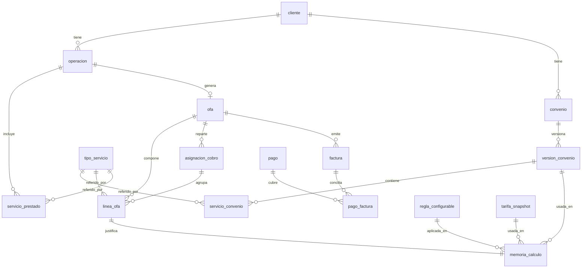

# Modelo de datos — Satélite de Facturación AEXSA

Versión: 1.0
Fecha: 2026-10-26
Autor: Arquitecto de Solución (`arquitecto-satelite`)
Base: ADR-010 (modelo de datos, auditoría y trazabilidad), ADR-006/007/008/011, `design.md` §3.
Motor: **PostgreSQL** (estándar corporativo). Mapeo vía EF Core (ADR-001).
Propósito: especificar el **modelo físico** (tablas, columnas, tipos, claves, índices) que materializa el dominio. Es la base para la migración inicial de EF Core.

> Principios aplicados: identidad de cliente por **RUT** (BR-020); versionado con vigencia en convenios/tarifas/reglas (un cálculo fija la versión usada); **auditoría append-only** (`memoria_calculo`, `evento_auditoria`); **folio** como clave de cuadratura operación↔OFA↔factura↔pago (RN-029, RNF-02).

---

## 1. Diagrama entidad-relación



---

## 2. Convenciones
- Nombres en `snake_case`, tablas en singular.
- Claves primarias **`uuid`** (`gen_random_uuid()`), salvo catálogos que conservan su clave natural de AEXSA.
- Montos: `numeric(18,4)`; moneda como `char(3)` (`CLP|USD|UF`). Tipo de cambio: `numeric(12,4)`.
- Fechas de evento/operación: `timestamptz`. Vigencias: `date`.
- Auditoría append-only: sin `UPDATE`/`DELETE`; un cambio inserta una fila nueva.
- Enums como `text` + `CHECK` (claridad y portabilidad) salvo que se opte por tipos enum nativos.

---

## 3. DDL (PostgreSQL)

### 3.1 Cliente y catálogo de servicios

```sql
-- Identidad por RUT (BR-020); mapeo a SAP (RN-065).
CREATE TABLE cliente (
    id              uuid PRIMARY KEY DEFAULT gen_random_uuid(),
    rut             varchar(12) NOT NULL UNIQUE,         -- identidad canonica
    razon_social    text NOT NULL,
    card_code_sap   varchar(30),                         -- socio de negocio SAP (PA-007)
    condicion_pago  text CHECK (condicion_pago IN ('CONTADO','CREDITO')), -- RN-065/020
    dias_credito    int,                                 -- 7/15/30 (RN-066)
    lista_precios_id varchar(30),                        -- lista de precios SAP
    creado_en       timestamptz NOT NULL DEFAULT now()
);

-- Catalogo normalizado desde MasterData.TipoServicio (192) (RN-032, BR-014).
CREATE TABLE tipo_servicio (
    tipo_servicio_id    int PRIMARY KEY,                 -- clave natural de AEXSA
    codigo              varchar(20) NOT NULL,
    descripcion         text NOT NULL,
    unidad_normalizada  text NOT NULL CHECK (unidad_normalizada IN
                         ('BL','DUS','CTR','CTR_DIA','TON','M3','CAMION','PALLET','UNIDAD')), -- BR-014/RN-048
    unidad_origen       text,                            -- texto crudo de AEXSA (referencia)
    habilitado          boolean NOT NULL DEFAULT true    -- solo Habilitado se factura (RN-032)
);
```

### 3.2 Convenios versionados (ADR-007)

```sql
CREATE TABLE convenio (
    id          uuid PRIMARY KEY DEFAULT gen_random_uuid(),
    cliente_id  uuid NOT NULL REFERENCES cliente(id),
    comercial   text,                                    -- RN-016
    creado_en   timestamptz NOT NULL DEFAULT now()
);

CREATE TABLE version_convenio (
    id              uuid PRIMARY KEY DEFAULT gen_random_uuid(),
    convenio_id     uuid NOT NULL REFERENCES convenio(id),
    numero          int NOT NULL,                        -- correlativo de version
    estado          text NOT NULL CHECK (estado IN ('BORRADOR','VIGENTE','VENCIDA','REEMPLAZADA')),
    vigencia_desde  date NOT NULL,
    vigencia_hasta  date,                                -- +1 año tipico (RN-021)
    tc_minimo       numeric(12,4),                       -- piso USD->CLP (RN-022)
    dias_libres     int,                                 -- almacenaje (RN-023)
    origen          text CHECK (origen IN ('IA_EXTRAIDO','MANUAL','COMPLEMENTO_CORREO')), -- RN-071/037
    documento_s3    text,                                -- PDF/Word origen en S3
    confirmado_por  text,                                -- confirmacion humana (RN-071)
    confirmado_en   timestamptz,
    creado_en       timestamptz NOT NULL DEFAULT now(),
    UNIQUE (convenio_id, numero)
);
CREATE INDEX ix_version_convenio_vigente
    ON version_convenio (convenio_id, estado, vigencia_desde);

CREATE TABLE servicio_convenio (
    id                  uuid PRIMARY KEY DEFAULT gen_random_uuid(),
    version_convenio_id uuid NOT NULL REFERENCES version_convenio(id),
    tipo_servicio_id    int  NOT NULL REFERENCES tipo_servicio(tipo_servicio_id),
    tarifa              numeric(18,4) NOT NULL,
    moneda              char(3) NOT NULL CHECK (moneda IN ('CLP','USD','UF')), -- RN-022/036
    unidad              text NOT NULL                    -- RN-036
);
```

### 3.3 Operación y servicios prestados (ADR-005/010/011)

```sql
CREATE TABLE operacion (
    id                  uuid PRIMARY KEY DEFAULT gen_random_uuid(),
    operacion_id_aexsa  varchar(40) NOT NULL UNIQUE,     -- idempotencia de ingesta
    cliente_id          uuid REFERENCES cliente(id),
    tipo_carga          text CHECK (tipo_carga IN ('CONTENEDOR','BULTO')),       -- RN-027
    tipo_retiro         text CHECK (tipo_retiro IN ('DIRECTO','INDIRECTO')),     -- RN-026
    con_convenio        boolean NOT NULL DEFAULT false,
    puerto              text,
    din                 varchar(40),                     -- declaracion import
    dus                 varchar(40),                     -- declaracion export (ref); BL<->DUS 1:N
    cantidad_dus        int,                             -- driver de cobro expo; CAPTURA MANUAL (RN-047, adenda A2)
    terminal            text CHECK (terminal IN ('STI','DP_WORLD','OTRO')), -- terminal de retiro; gobierna refacturacion del directo (RN-079, ADR-015)
    ruta_clasificada    text,                            -- {carga}x{retiro}x{convenio} (REQ-002)
    momento_facturacion text CHECK (momento_facturacion IN ('EN_VISACION','POST_DESPACHO')), -- RN-046
    facturable          boolean NOT NULL DEFAULT true,   -- false si DIN<>papeleta (RN-001)
    ingerido_en         timestamptz NOT NULL DEFAULT now()
);
CREATE INDEX ix_operacion_cliente ON operacion (cliente_id);

CREATE TABLE servicio_prestado (
    id               uuid PRIMARY KEY DEFAULT gen_random_uuid(),
    operacion_id     uuid NOT NULL REFERENCES operacion(id),
    tipo_servicio_id int  NOT NULL REFERENCES tipo_servicio(tipo_servicio_id),
    cantidad         numeric(18,4) NOT NULL,
    unidad           text NOT NULL,
    origen_dato      text                                -- reefer/inspeccion/almacenaje/complementario
);
CREATE INDEX ix_servicio_prestado_op ON servicio_prestado (operacion_id);
```

### 3.3b Catálogo SAP importado (ADR-017)

```sql
-- Cabecera de cada carga del catalogo (archivo Excel/CSV en Fase A, API en Fase B).
CREATE TABLE catalogo_snapshot (
    version         int PRIMARY KEY,
    fecha           timestamptz NOT NULL DEFAULT now(),
    origen          text NOT NULL CHECK (origen IN ('ARCHIVO_SAP','API_SAP')),
    archivo         text,                                -- archivo importado (S3)
    cargado_por     text NOT NULL,
    confirmado_por  text,                                -- confirmacion humana antes de activar
    confirmado_en   timestamptz
);

-- Kits de SAP: encabezado y composicion (RN-061). Referencia, no entrada del calculo.
CREATE TABLE sap_kit (
    id               uuid PRIMARY KEY DEFAULT gen_random_uuid(),
    snapshot_version int  NOT NULL REFERENCES catalogo_snapshot(version),
    kit_codigo       varchar(40) NOT NULL,
    nombre           text NOT NULL,
    ruta             text,                               -- ruta a la que aplica (directo, indirecto sin convenio, con convenio...)
    UNIQUE (snapshot_version, kit_codigo)
);

CREATE TABLE sap_kit_articulo (
    kit_id       uuid NOT NULL REFERENCES sap_kit(id),
    articulo_id  varchar(40) NOT NULL,
    cantidad     numeric(18,4) NOT NULL DEFAULT 1,
    PRIMARY KEY (kit_id, articulo_id)
);

-- Vinculo servicio del Satelite <-> articulo SAP (propuesta IA + confirmacion humana).
CREATE TABLE servicio_articulo_sap (
    tipo_servicio_id int NOT NULL REFERENCES tipo_servicio(tipo_servicio_id),
    articulo_id      varchar(40) NOT NULL,
    origen           text NOT NULL CHECK (origen IN ('IA_PROPUESTO','MANUAL')),
    confirmado_por   text,
    confirmado_en    timestamptz,
    PRIMARY KEY (tipo_servicio_id, articulo_id)
);

-- Tipo de cambio diario que usa el motor (RN-022). Preferente: el mismo que usa SAP al emitir.
CREATE TABLE tipo_cambio (
    fecha        date NOT NULL,
    moneda       char(3) NOT NULL CHECK (moneda IN ('USD','UF')),
    valor        numeric(12,4) NOT NULL,
    fuente       text NOT NULL,                          -- SAP | MANUAL
    cargado_por  text NOT NULL,
    PRIMARY KEY (fecha, moneda)
);
```

### 3.4 Tarifas de SAP (snapshot versionado, ADR-003)

```sql
CREATE TABLE tarifa_snapshot (
    id               uuid PRIMARY KEY DEFAULT gen_random_uuid(),
    version          int NOT NULL REFERENCES catalogo_snapshot(version), -- version del snapshot
    fecha            timestamptz NOT NULL DEFAULT now(),
    articulo_id      varchar(40) NOT NULL,               -- articulo SAP
    lista_precios_id varchar(30) NOT NULL,
    precio           numeric(18,4) NOT NULL,
    moneda           char(3) NOT NULL CHECK (moneda IN ('CLP','USD','UF')),
    UNIQUE (version, articulo_id, lista_precios_id)
);
```

### 3.5 Reglas configurables (ADR-008)

```sql
CREATE TABLE regla_configurable (
    id              uuid PRIMARY KEY DEFAULT gen_random_uuid(),
    nombre          text NOT NULL,
    condicion       jsonb NOT NULL,                      -- p.ej. {forwarder, puerto, concepto}
    accion          jsonb NOT NULL,                      -- agregar/poner_cero/aplicar_factor
    version         int NOT NULL,
    vigencia_desde  date NOT NULL,
    vigencia_hasta  date,
    creado_por      text NOT NULL,
    creado_en       timestamptz NOT NULL DEFAULT now()
);
```

### 3.6 OFA, líneas y repartido (ADR-010/011)

```sql
CREATE TABLE ofa (
    id                  uuid PRIMARY KEY DEFAULT gen_random_uuid(),
    operacion_id        uuid NOT NULL REFERENCES operacion(id),
    estado              text NOT NULL CHECK (estado IN
                         ('BORRADOR','VALIDADA','ENVIADA','EMITIDA',
                          'EMITIDA_SIN_CONFIRMACION','CONCILIADA')),   -- RNF-07
    folio_idempotencia  varchar(80) NOT NULL UNIQUE,      -- OfaId+version (ADR-002)
    fecha_calculo       timestamptz NOT NULL DEFAULT now(),
    version_calculo     int NOT NULL DEFAULT 1
);
CREATE INDEX ix_ofa_operacion ON ofa (operacion_id);
CREATE INDEX ix_ofa_estado    ON ofa (estado);

-- Repartido: varios destinatarios por operacion (RN-050/077).
CREATE TABLE asignacion_cobro (
    id               uuid PRIMARY KEY DEFAULT gen_random_uuid(),
    ofa_id           uuid NOT NULL REFERENCES ofa(id),
    destinatario_rut varchar(12) NOT NULL,                -- RUT de la DIN/DUS (RN-057)
    rol              text CHECK (rol IN ('CONSIGNATARIO','FORWARDER','EMBARCADOR')), -- RN-050
    origen_instruccion text                               -- correo/default (BR-024)
);

CREATE TABLE linea_ofa (
    id                  uuid PRIMARY KEY DEFAULT gen_random_uuid(),
    ofa_id              uuid NOT NULL REFERENCES ofa(id),
    asignacion_cobro_id uuid REFERENCES asignacion_cobro(id),   -- a quien se cobra esta linea
    tipo_servicio_id    int  NOT NULL REFERENCES tipo_servicio(tipo_servicio_id),
    cantidad            numeric(18,4) NOT NULL,
    unidad              text NOT NULL,
    tarifa              numeric(18,4) NOT NULL,
    moneda              char(3) NOT NULL CHECK (moneda IN ('CLP','USD','UF')),
    monto               numeric(18,4) NOT NULL,            -- en CLP tras conversion
    es_excepcion        boolean NOT NULL DEFAULT false     -- tarifa publica sin convenio (RN-006)
);
CREATE INDEX ix_linea_ofa_ofa ON linea_ofa (ofa_id);
```

### 3.7 Memoria de cálculo (append-only, ADR-006/010)

```sql
-- Reconstruccion del "por que" de cada monto (REQ-011, RNF-01). NO se actualiza ni borra.
CREATE TABLE memoria_calculo (
    id                  uuid PRIMARY KEY DEFAULT gen_random_uuid(),
    linea_ofa_id        uuid NOT NULL REFERENCES linea_ofa(id),
    reglas_aplicadas    jsonb NOT NULL,                   -- [{regla, version}]
    version_convenio_id uuid REFERENCES version_convenio(id),
    tarifa_snapshot_ver int,                              -- version del snapshot usado
    tipo_cambio         numeric(12,4),                    -- TC del dia aplicado (RN-022)
    regla_config_id     uuid REFERENCES regla_configurable(id),
    ajuste_manual       jsonb,                            -- {usuario,fecha,motivo,valor_ant,valor_nuevo} (REQ-006)
    calculado_en        timestamptz NOT NULL DEFAULT now()
);
CREATE INDEX ix_memoria_linea ON memoria_calculo (linea_ofa_id);
```

### 3.8 Factura y pago (ADR-004/010)

```sql
CREATE TABLE factura (
    id           uuid PRIMARY KEY DEFAULT gen_random_uuid(),
    ofa_id       uuid NOT NULL REFERENCES ofa(id),
    folio        varchar(40) NOT NULL UNIQUE,             -- clave de cuadratura (RN-029)
    tipo_dte     int NOT NULL,                            -- 33/34/52/56/61/110/111/112 (RN-034)
    monto_neto   numeric(18,4),
    monto_total  numeric(18,4),
    moneda       char(3) NOT NULL DEFAULT 'CLP',
    dte_xml_s3   text,                                    -- XML del DTE en S3 (RN-076)
    emitida_en   timestamptz,
    conciliada   boolean NOT NULL DEFAULT false
);
CREATE INDEX ix_factura_ofa ON factura (ofa_id);

CREATE TABLE pago (
    id               uuid PRIMARY KEY DEFAULT gen_random_uuid(),
    referencia_sap   varchar(40),                         -- Pago Recibido (PR) en SAP (RN-063)
    pagador_rut      varchar(12),                         -- quien efectuo el pago (RN-069)
    monto            numeric(18,4) NOT NULL,
    fecha_pago       date,
    estado           text CHECK (estado IN ('PAGADA','PENDIENTE','PARCIAL')),
    registrado_en    timestamptz NOT NULL DEFAULT now()
);

-- Un pago agrupa varias facturas / varios clientes (RN-067).
CREATE TABLE pago_factura (
    pago_id      uuid NOT NULL REFERENCES pago(id),
    factura_id   uuid NOT NULL REFERENCES factura(id),
    monto_aplicado numeric(18,4) NOT NULL,
    PRIMARY KEY (pago_id, factura_id)
);
```

### 3.9 Auditoría e integración

```sql
-- Log transversal append-only (quien, cuando, que) (RNF-01).
CREATE TABLE evento_auditoria (
    id            bigserial PRIMARY KEY,
    entidad       text NOT NULL,                          -- tabla/agregado afectado
    entidad_id    uuid,
    accion        text NOT NULL,
    usuario       text NOT NULL,
    valor_anterior jsonb,
    valor_nuevo   jsonb,
    ocurrido_en   timestamptz NOT NULL DEFAULT now()
);
CREATE INDEX ix_auditoria_entidad ON evento_auditoria (entidad, entidad_id);
CREATE INDEX ix_auditoria_fecha   ON evento_auditoria (ocurrido_en);

-- Outbox transaccional para escritura hacia SAP (ADR-002).
CREATE TABLE outbox_message (
    id            uuid PRIMARY KEY DEFAULT gen_random_uuid(),
    tipo          text NOT NULL,                          -- OFA_PENDIENTE, etc.
    payload       jsonb NOT NULL,
    clave_idempotencia varchar(80) NOT NULL,              -- evita doble orden en SAP
    estado        text NOT NULL CHECK (estado IN ('PENDIENTE','ENVIADO','ERROR','REPROCESAR')),
    intentos      int NOT NULL DEFAULT 0,
    ultimo_error  text,
    creado_en     timestamptz NOT NULL DEFAULT now(),
    procesado_en  timestamptz
);
CREATE INDEX ix_outbox_pendiente ON outbox_message (estado, creado_en);
```

---

## 4. Trazabilidad de cuadratura (la columna vertebral)

El **folio** une toda la cadena (RNF-02, RN-029):

```
operacion.id ─▶ ofa.operacion_id
ofa.id       ─▶ factura.ofa_id
factura.folio ◀── clave de union con SAP y con el retorno a AEXSA (ADR-004)
factura.id   ─▶ pago_factura.factura_id ─▶ pago.id
```

Reconstrucción de un monto (REQ-011): `linea_ofa` → `memoria_calculo` → (`version_convenio`, `tarifa_snapshot`, `regla_configurable`, `tipo_cambio`, `ajuste_manual`). Nada se pierde porque esas filas son inmutables y versionadas.

---

## 5. Notas de implementación
- El DDL es la **especificación**; la creación real se hace por **migraciones EF Core** versionadas (ADR-001, aplicadas en el despliegue).
- `gen_random_uuid()` requiere `pgcrypto` (o `uuid-ossp`); habilitar la extensión en la migración inicial.
- Candidatos a **particionar por fecha** si crecen: `evento_auditoria`, `memoria_calculo` (append-only de alto volumen, RNF-04).
- Datos personales (cliente, convenios, factura): cifrado en reposo (RDS KMS) y control de acceso por rol (BR-021, PA-005).
- Pendiente de dato de negocio que NO cambia el esquema, solo valores: mecánica fina del DUS (BR-030), criterio STI/DPW (PQ-006).
