# Motor de tarifas — diseño detallado

Versión: 1.0
Fecha: 2026-10-26
Autor: Arquitecto de Solución (`arquitecto-satelite`)
Base: ADR-006 (motor determinístico), ADR-008 (capa configurable), ADR-011 (repartido/DUS), `modelo-datos.md`.
Propósito: especificar el **cómo** del cálculo de montos a nivel construible: el pipeline de reglas, la entrada (`ContextoCalculo`), la salida auditable (`MemoriaCalculo`) y cada regla con su lógica y casos de prueba. Es el núcleo de la Entrega 2 (factura con valores ajustados).

> Principio rector (RNF-03): el cálculo es **determinístico, reproducible y auditable**. La IA nunca fija un monto. Dado el mismo `ContextoCalculo`, el resultado es idéntico bit a bit. Cada monto se reconstruye leyendo su `MemoriaCalculo`.

---

## 1. Idea central

El motor valoriza una operación aplicando una **canalización (pipeline) de reglas puras y ordenadas**. Cada regla es una función `(ContextoCalculo, estado parcial) → aporte`, sin estado oculto, sin IA, sin aleatoriedad. El pipeline produce las `LineaOfa` valorizadas y, por cada una, su `MemoriaCalculo`.

```mermaid
flowchart LR
    CTX[ContextoCalculo<br/>inmutable] --> P1[1. Resolver tarifa<br/>convenio -> publica]
    P1 --> P2[2. Calcular cantidad<br/>por unidad / DUS / mayor m3-ton]
    P2 --> P3[3. Convertir moneda<br/>USD->CLP con piso TC]
    P3 --> P4[4. Almacenaje<br/>dias - dias libres / aforo]
    P4 --> P5[5. Recargos<br/>15% / 90% / sobrepeso / fuera horario]
    P5 --> P6[6. Reglas configurables<br/>nivel 2]
    P6 --> P7[7. Ajuste manual<br/>nivel 3 - auditable]
    P7 --> OUT[LineaOfa + MemoriaCalculo]
```



El orden importa: la tarifa se resuelve antes de la cantidad; la conversión de moneda antes de los recargos (que son porcentajes sobre el monto); los ajustes manuales al final (tienen la última palabra, registrada).

---

## 2. Entrada: `ContextoCalculo` (inmutable)

Todo lo que el cálculo necesita viaja en un objeto inmutable. No se consulta nada "en vivo" durante el cálculo (reproducibilidad).

```csharp
public sealed record ContextoCalculo(
    Guid OperacionId,
    string Puerto,                       // STI | DPW ... (RN-007)
    bool ConConvenio,
    bool EsExportacion,                  // expo -> DUS (RN-047)
    int? CantidadDus,                    // driver de cobro expo (RN-047)
    VersionConvenioSnapshot? Convenio,   // version fijada (null si sin convenio)
    TarifaPublicaSnapshot TarifaPublica, // kit spot SAP, version fijada (RN-014)
    decimal TipoCambioDia,               // USD observado del dia
    IReadOnlyList<ServicioACobrar> Servicios,
    IReadOnlyList<ReglaConfigurable> ReglasVigentes,
    CondicionAlmacenaje Almacenaje       // dias calculados, aforo, etc.
);

public sealed record ServicioACobrar(
    int TipoServicioId,
    decimal Cantidad,
    UnidadCobro Unidad,                  // BL|DUS|CTR|CTR_DIA|TON|M3...
    decimal? MetrosCubicos,              // para "el mayor paga" (RN-048)
    decimal? Toneladas
);
```

Clave: `Convenio` y `TarifaPublica` son **snapshots con versión** (no referencias vivas). El `TipoCambioDia` entra como dato, no se consulta dentro del cálculo.

---

## 3. Salida: `LineaOfa` + `MemoriaCalculo` (append-only)

Cada servicio produce una línea con su monto final y una memoria que explica el "por qué":

```csharp
public sealed record ResultadoLinea(
    int TipoServicioId,
    decimal Cantidad,
    UnidadCobro Unidad,
    decimal Tarifa,
    string Moneda,                       // moneda de origen de la tarifa
    decimal MontoClp,                    // monto final en CLP
    bool EsExcepcion,                    // tarifa publica dentro de convenio (RN-006)
    MemoriaCalculo Memoria
);

// Reconstruccion del monto (REQ-011, RNF-01) — ver modelo-datos.md
public sealed record MemoriaCalculo(
    IReadOnlyList<ReglaAplicada> Reglas, // [{regla, version, resultado}]
    int? VersionConvenio,
    int VersionTarifaPublica,
    decimal? TipoCambioAplicado,
    Guid? ReglaConfigurableId,
    AjusteManual? Ajuste                 // {usuario, fecha, motivo, valorAnterior, valorNuevo}
);
```

---

## 4. Las reglas, una por una

### Regla 1 — Resolución de tarifa (RN-006, RN-014, RN-045)
- Si el servicio tiene tarifa en el **convenio vigente** → usa esa (precedencia del convenio, RN-045).
- Si no está en el convenio → usa la **tarifa pública / kit spot** de SAP y marca la línea `EsExcepcion = true` (RN-006).
- Si no hay convenio → todo con tarifa pública.
- Registra en memoria: fuente de la tarifa (convenio vX / snapshot público vY).

### Regla 2 — Cantidad por unidad (RN-047, RN-048)
- Unidad del servicio define el multiplicador: BL, DUS, CTR, TON, M3, CTR-DÍA…
- **Expo con driver DUS:** cantidad = `CantidadDus` (RN-047).
- **"El mayor paga"** cuando el concepto es por volumen/peso: cantidad = `max(MetrosCubicos, Toneladas)` (RN-048).
- Registra qué driver y qué cantidad se usó.

### Regla 3 — Conversión de moneda (RN-022)
- Si la tarifa está en CLP → sin conversión.
- Si está en USD → `montoClp = cantidad × tarifa × max(TipoCambioDia, TcMinimoConvenio)`.
- El **piso de TC** del convenio nunca se viola: si el dólar del día < piso, se usa el piso (RN-022).
- Registra el TC aplicado y si se activó el piso.

### Regla 4 — Almacenaje (RN-023, RN-051, RN-052)
- Días a cobrar = `diasCalculados − diasLibresConvenio` (nunca negativo) (RN-023/051).
- Si hay **aforo**, los días bajo aforo **no se cobran** (RN-052): se descuentan del cómputo.
- Monto = `diasACobrar × tarifaAlmacenaje` (unidad CTR-DÍA).
- Registra días calculados, días libres, días bajo aforo y días netos cobrados.

### Regla 5 — Recargos (RN-024)
- Sobre el monto correspondiente, aplica el recargo que proceda **solo si está indicado** (hoy llega por instrucción comercial, PQ-020; en el Satélite es una regla configurable o un ajuste):
  - 15% refacturación a terceros (RN-024),
  - 90% falso flete,
  - sobrepeso, habilitación fuera de horario.
- Registra qué recargo, su base y su porcentaje.

### Regla 6 — Reglas configurables (ADR-008, nivel 2)
- Evalúa las `ReglasVigentes` cuya condición (forwarder/puerto/concepto) hace match: agregar concepto, poner en cero, aplicar factor (p. ej. STI vs DPW cuando se cierre PQ-006).
- Es determinística: la regla está versionada y parametrizada, no es código libre.
- Registra qué regla configurable se aplicó.

### Regla 7 — Ajuste manual (ADR-008, nivel 3)
- Si un facturador ajusta concepto/monto/excepción, se aplica **al final** y se registra `{usuario, fecha, motivo, valorAnterior, valorNuevo}` (REQ-006).
- El monto lo fija la persona, no la IA; sigue siendo determinístico porque queda como dato inmutable en la memoria.

---

## 5. Casos de prueba (derivados del levantamiento)

El determinismo se garantiza con pruebas. Mínimo obligatorio (cada uno es un test unitario con entrada fija → salida esperada):

| # | Caso | Regla | Entrada clave | Resultado esperado |
|---|------|-------|---------------|--------------------|
| T1 | Tarifa de convenio simple CLP | R1,R2 | 2 CTR × 15.000 CLP | 30.000 CLP |
| T2 | Tarifa USD sobre piso | R3 | 1 × 100 USD, TC día 950, piso 800 | 95.000 CLP (usa 950) |
| T3 | Tarifa USD bajo piso | R3 | 1 × 100 USD, TC día 700, piso 800 | 80.000 CLP (usa piso 800) |
| T4 | Ítem sin tarifa de convenio | R1 | servicio fuera del convenio | usa pública, `EsExcepcion=true` |
| T5 | Almacenaje con días libres | R4 | 12 días calc., 10 libres | cobra 2 días |
| T6 | Almacenaje bajo aforo | R4 | 5 días, 3 bajo aforo, 0 libres | cobra 2 días |
| T7 | Mayor m³/ton | R2 | m³=18, ton=12 | cobra por 18 |
| T8 | Cobro por DUS (expo) | R2 | 3 DUS | cantidad = 3 |
| T9 | Recargo 15% refacturación | R5 | base 100.000 | +15.000 |
| T10 | Regla configurable pone ítem en cero | R6 | puerto DPW, ítem refacturación | monto = 0 |
| T11 | Ajuste manual auditable | R7 | ajuste −5.000 con motivo | monto ajustado + memoria con autor |
| T12 | Reproducibilidad | pipeline | mismo contexto dos veces | resultado idéntico |

> Estos casos usan valores del levantamiento (pisos 650/700/750/800 RN-022; días libres 5/7/10/15 RN-023; recargo 15% RN-024; DUS RN-047; mayor m³/ton RN-048). Al confirmarse STI/DPW (PQ-006) se agrega el caso real de T10.

---

## 6. Qué queda fuera del motor (por diseño)
- **La IA no interviene** en el cálculo. Puede proponer un ajuste o una regla (ADR-008/009), pero entra como propuesta que un humano confirma; el motor solo ejecuta reglas y ajustes ya fijados.
- **El IVA y la emisión del DTE** los hace SAP (RN-025/059); el motor entrega el neto valorizado para la OFA.
- Reglas no escritas aún no automatizadas: se cubren con nivel 2/3 (configurable/manual), no bloquean el cálculo (RN-070).

## 7. Dependencias abiertas
- **PQ-006 (STI vs DPW):** se implementa como regla configurable (R6) en cuanto el negocio confirme el criterio. El motor ya lo soporta.
- **BR-030 (mecánica DUS):** la cantidad de DUS entra por `CantidadDus`; falta confirmar cómo se obtiene por operación.
- **PA-003:** la tarifa pública (snapshot) depende de la lectura real de SAP; hasta entonces, stub con datos de ejemplo.
