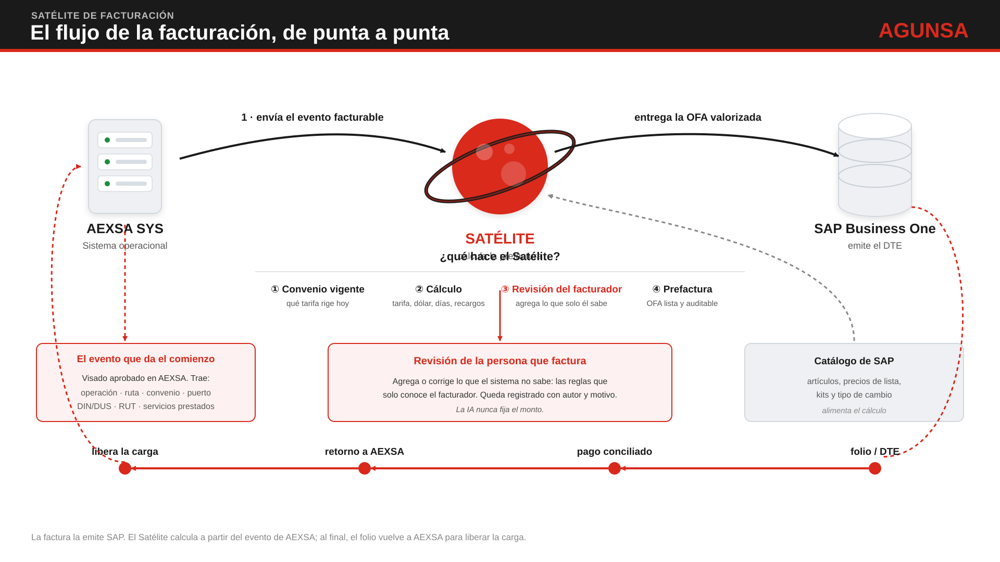

# Guía del desarrollador — Satélite de Facturación AEXSA

Versión: 1.0 · Fecha: 2026-11-04
Para: la persona que construirá el Satélite con Kiro.
Léela completa una vez (unos 20 minutos). Después úsala como mapa.

---

## 1. Qué vas a construir

Hoy AEXSA factura a mano. El sistema operacional (AEXSA SYS) no alimenta a SAP, el convenio de cada cliente vive disperso en correos y carpetas, y el monto se calcula caso a caso. Eso produce errores, notas de crédito y cobros que se pierden.

El **Satélite** es un sistema nuevo que:
1. Recibe el **evento facturable** que AEXSA SYS envía al aprobarse un visado.
2. Resuelve el **convenio vigente** del cliente (guardado en el Satélite, versionado).
3. **Calcula el monto** con reglas fijas, en un orden fijo, sin IA.
4. Deja que el **facturador revise** y agregue lo que solo él sabe, con registro de quién y por qué.
5. Arma la **prefactura valorizada (OFA)**.
6. En la Fase B, la entrega a SAP, recibe el folio, concilia el pago y avisa a AEXSA SYS.



El detalle del cálculo, regla por regla, está en `diagramas/flujo-calculo.svg` y en `docs/arquitectura/motor-tarifas-detalle.md`.

## 2. Las dos fases

| | Fase A | Fase B |
|---|---|---|
| **Qué entrega** | Convenio único y vigente, prefactura valorizada **que el facturador digita en SAP como hoy**, y alerta de cobros omitidos | Fin de la digitación: escritura automática en SAP, folio, pagos y retorno a AEXSA SYS |
| **Depende de terceros** | Casi nada: archivos de catálogo de SAP y un app client de Cognito | Sí: SAP, Agunsa Connect, AEXSA SYS, ciberseguridad |
| **Empiezas por** | Aquí | Después, contra simuladores |

**Regla práctica:** construye todo lo que toca a un tercero detrás de un **puerto** con un **simulador**. Así avanzas aunque el tercero no haya respondido. Cuando responda, enchufas el adaptador real sin tocar el dominio.

## 3. Cómo está organizado el repositorio

```
README.md                                  Entrada rápida
.kiro/
  specs/satelite-facturacion/
    design.md                              CÓMO está diseñado (capas, dominio, flujo, integraciones)
    tasks.md                               QUÉ construir y en qué orden (tareas)
  steering/                                Reglas que Kiro aplica siempre mientras trabajas
docs/
  desarrollo/                              <- estás aquí
    GUIA-DESARROLLADOR.md                  Esta guía
    requerimientos.md                      QUÉ pide el negocio (REQ-001 a REQ-012)
    reglas-negocio.md                      Las 79 reglas (RN-001 a RN-079), texto completo
    glosario.md                            Términos del negocio explicados
    formato-archivos-catalogo-sap.md       Columnas de los CSV que exporta SAP
    diagramas/                             Flujo del sistema y del cálculo
  arquitectura/
    adr/                                   17 decisiones de arquitectura (empieza por ADR-000-indice.md)
    modelo-datos.md                        DDL de PostgreSQL
    motor-tarifas-detalle.md               Pipeline de reglas y casos de prueba T1 a T12
    contratos-integracion.md               Contratos de los puertos (SAP, AEXSA)
    api/openapi.yaml                       Contrato REST entre frontend y backend
    estrategia-pruebas.md                  Cómo se prueba
    arquitectura-despliegue.md             AWS, red, CI/CD
    mapa-pantallas.md                      Pantallas por rol y su API
    restricciones-tecnicas.md              Lo confirmado y lo pendiente
```

## 4. Orden de lectura

| # | Qué leer | Para qué | Tiempo |
|---|---|---|---|
| 1 | Esta guía | Ubicarte | 20 min |
| 2 | `glosario.md` | Entender el vocabulario | 10 min |
| 3 | `requerimientos.md` (empieza por "Ajustes vigentes") | Qué quiere el negocio | 20 min |
| 4 | `design.md` | La arquitectura | 25 min |
| 5 | `adr/ADR-000-indice.md` y los ADR 001, 002, 006, 010 | Las decisiones que más condicionan | 30 min |
| 6 | `motor-tarifas-detalle.md` | El núcleo del valor | 25 min |
| 7 | `tasks.md` (sección "Orden de ejecución") | Qué haces primero | 15 min |
| 8 | `reglas-negocio.md` | Consulta, no lectura completa. Búscala cuando una tarea cite una regla | — |

Los demás documentos se leen cuando la tarea los pide.

## 5. Reglas que no se negocian

1. **La IA nunca fija un monto.** El cálculo es determinístico y versionado. Si algún día se activa la IA, solo propone y una persona confirma.
2. **Determinismo.** Mismo `ContextoCalculo`, mismo resultado, siempre. El motor no lee el reloj, no usa azar ni cultura/locale, y no consulta nada en vivo. Todo entra como dato (incluido el tipo de cambio). Usa `decimal`, nunca `double`.
3. **Todo monto es reconstruible.** Cada línea guarda su memoria de cálculo (reglas y versiones, versión del convenio y del catálogo, dólar aplicado, ajustes). Las tablas de memoria y auditoría son **append-only**.
4. **Versiona lo que cambia en el tiempo:** convenios, tarifas, catálogo y reglas. Un cálculo guarda la versión que usó.
5. **Terceros detrás de un puerto, con simulador.** Nunca llames a SAP o a AEXSA desde el dominio.
6. **Integración con SAP por Outbox,** con idempotencia, reintentos configurables, log de solicitud, respuesta y error, validación antes de transmitir, aviso ante fallo y reenvío desde la interfaz sin tocar la base. Nunca llamadas síncronas ni "dispara y olvida". Los módulos se comunican con eventos de dominio.
7. **Seguridad.** Sin contraseñas ni secretos en el código ni en la configuración (usa Secrets Manager). Autorización por rol **en la API**, no solo en los menús. Un token válido de otro app client se rechaza.
8. **Sin datos reales en el repositorio.** Ni de clientes ni de SAP, ni en pruebas ni en ejemplos. Todo dato de prueba es inventado.
9. **Fechas `AAAA-MM-DD`; montos siempre con moneda** (CLP, USD, UF).
10. **Si el contrato cambia, cambia el archivo.** Un endpoint nuevo o modificado actualiza `openapi.yaml` en el mismo cambio.

## 6. Tu stack

| Capa | Tecnología |
|---|---|
| Backend | .NET 10 (LTS) y Entity Framework Core |
| API | REST (contrato en `openapi.yaml`) |
| Base de datos | PostgreSQL |
| Frontend | Angular |
| Pruebas | xUnit, FluentAssertions, FsCheck (propiedades), Testcontainers, WebApplicationFactory |
| Infraestructura | AWS: ECS Fargate, RDS, S3, CloudFront y WAF |
| CI/CD | GitHub Actions y ECR |

Estructura de la solución (tarea 0.1): `Satelite.Dominio`, `Satelite.Aplicacion`, `Satelite.Infraestructura`, `Satelite.Api`, `Satelite.Worker` y `Satelite.Tests`. El dominio no depende de nada. Los nombres del dominio van en español, como en `modelo-datos.md` (`Operacion`, `LineaOfa`, `catalogo_snapshot`).

## 7. Cómo trabajar con Kiro

1. **Abre la carpeta del repositorio en Kiro.** Kiro carga solo los archivos de `.kiro/steering/`: ahí están las reglas de arriba y el contexto del proyecto.
2. **Abre `.kiro/specs/satelite-facturacion/tasks.md`** y ejecuta las tareas **en el orden recomendado** de su primera sección, no por número.
3. Si Kiro pide un `requirements.md` junto al diseño, copia `docs/desarrollo/requerimientos.md` a `.kiro/specs/satelite-facturacion/requirements.md` **en tu máquina**. Git lo ignora a propósito.
4. Antes de cada tarea, lee las reglas (`RN-xxx`) y los ADR que la tarea cita. Están en esta carpeta y en `adr/`.
5. **Pruebas primero en el motor de tarifas.** Los casos T1 a T12 de `motor-tarifas-detalle.md` son obligatorios y se escriben antes del código.
6. Al terminar cada tarea, marca `[x]` y llena la tabla de **Registro de avance** al final de `tasks.md`.

**Frases que funcionan bien con Kiro:**
- "Lee `docs/desarrollo/GUIA-DESARROLLADOR.md` y `.kiro/specs/satelite-facturacion/tasks.md`. Ejecuta la tarea 0.1."
- "Implementa la tarea 1.3. Escribe primero las pruebas T1 a T4 y T12 de `motor-tarifas-detalle.md`."
- "Revisa que los endpoints que acabas de crear coincidan con `docs/arquitectura/api/openapi.yaml`."
- "Genera archivos de ejemplo del catálogo según `formato-archivos-catalogo-sap.md`, con datos inventados y algunos errores a propósito."

## 8. Definición de "hecho"

Una tarea se cierra solo si: compila y el pipeline está en verde; tiene pruebas y pasan; los endpoints coinciden con `openapi.yaml`; no hay secretos ni datos reales; todo cambio de monto queda en la auditoría; y completaste el registro de avance.

Cada prueba de aceptación debería citar el `REQ` o la `RN` que cubre. Así el negocio puede seguir la trazabilidad de requerimiento a prueba.

## 9. Lo que NO está resuelto (y cómo comportarte)

Ninguno de estos puntos te bloquea. Todos tienen una forma de avanzar.

| Tema | Estado | Qué haces mientras tanto |
|---|---|---|
| **Escritura en SAP y contrato de Agunsa Connect** (PA-001, PA-002) | Abierto. Es el bloqueante técnico de la Fase B | Simulador `AgunsaConnectSapAdapter`. El contrato está en `contratos-integracion.md` |
| **Lectura de SAP por API** (PA-003) | Abierto | En la Fase A el catálogo entra por archivo (ADR-017) |
| **Cómo llega el evento desde AEXSA SYS** (PA-006) | Abierto | Tarea 3.1a: simulador, `POST /aexsa/eventos` y alta manual de operación como puente |
| **Retorno a AEXSA SYS** (PA-004, PA-008) | Abierto | Simulador. Es Fase B |
| **Ciberseguridad y datos personales** (PA-005) | Abierto | Respeta las reglas de seguridad de la sección 5 |
| **App client y roles de Cognito** (PA-009) | Abierto | Autoridad y audiencia configurables. En pruebas, autenticación de prueba con usuarios y roles |
| **Archivos de catálogo de SAP** (PQ-025) | A la espera de la fecha del equipo SAP | Archivos de ejemplo con el formato documentado |
| **Si el folio vuelve al Satélite en la Fase A** | `[POR CONFIRMAR]` | La OFA queda "lista para digitar". No construyas el registro del folio hasta que se defina |
| **Mecánica fina del cobro por DUS** (BR-030) | Abierto | `CantidadDus` es captura manual. Qué se cobra por DUS lo define el convenio |
| **Fecha de inicio y plazo** | Lo definen la jefatura de TI | No afecta el orden de las tareas |

**Si descubres algo que no está en los documentos:** no lo inventes. Márcalo `[SUPUESTO: razón]` en el código o en el registro de avance y avisa a TI del proyecto.
**Si dos documentos se contradicen:** gana el más reciente. Si es una regla de negocio, gana la de número mayor (ver `reglas-negocio.md`).

## 10. Qué recibes fuera del repositorio

Por canal interno, no por git:
- **Prototipo navegable** (carpeta de páginas HTML). Muestra cómo debe verse y sentirse la interfaz. Tiene datos de ejemplo y algunas pantallas aún traen notas de IA y tarjetas de indicadores que ya se decidió **no** construir. Lo que dicen `mapa-pantallas.md` y los "Ajustes vigentes" de `requerimientos.md` prevalece sobre el prototipo.
- **Acceso al repositorio, a la cuenta de AWS y al pipeline,** según lo que defina TI.
- **Los archivos de catálogo reales de SAP,** cuando el equipo SAP los entregue.

No recibirás los documentos originales del levantamiento ni los convenios de los clientes, por la ley de protección de datos personales. Lo que necesitas para construir está en esta carpeta.

## 11. A quién preguntar

| Duda sobre | A quién |
|---|---|
| Arquitectura, alcance, prioridades, accesos | TI del proyecto (responsable de la iniciativa) |
| Cómo factura hoy una situación concreta | Facturación (jefatura y facturadores) |
| Convenios y tarifas | Área comercial |
| Pagos y conciliación | Recaudación |
| Catálogo, kits y API de SAP | Equipo SAP |
| Cognito y Entra ID | Quien administra el pool de identidad |

Las preguntas de negocio pasan siempre por TI del proyecto, que ordena la consulta.
